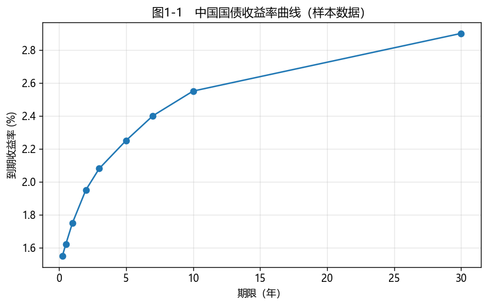

# 第1章　固定收益证券与中国债券市场概述

[](https://colab.research.google.com/github/albertandking/fixed-income/blob/main/notebooks/ch01_fi_overview.ipynb) [](https://mybinder.org/v2/gh/albertandking/fixed-income/main?labpath=notebooks/ch01_fi_overview.ipynb)

!!! info "配套代码"
    本章末尾用 `fi.data` 加载内置国债收益率曲线样本并画出第一张图；环境搭建详见[附录A](../appendix/a-setup.md)。

## 1.1 本章导读与学习目标

本章从固定收益证券的基本概念出发。股票代表对企业剩余收益的所有权，债券则是按合同约定生成现金流的债权凭证。"约定"的是支付规则和偿付顺序，并不意味着每笔现金流的金额始终固定，更不意味着投资者不承担风险。债券市场为政府、金融机构和非金融企业提供融资渠道，并在基准利率形成、流动性管理和货币政策传导中发挥重要作用。本章将依次介绍固定收益证券的特征、中国债券市场的结构与监管分工、政策利率与市场基准利率的关系，最后说明本书使用的 Python 计算环境。

!!! abstract "学习目标"
    学完本章，读者应能：

    1. 说明固定收益市场在中国金融体系中的**地位与四大核心功能**（融资、定价基准、流动性管理、货币政策传导）；
    2. 归纳固定收益证券的**三类特征**（基础性、现金流、风险收益）；
    3. 描述中国债券市场的**结构**（银行间市场与交易所市场）、**主要品种**、**市场基础设施**与**分工监管**格局；
    4. 认识中国的**政策利率与基准利率体系**（OMO、MLF、LPR、SHIBOR、DR007、利率走廊）；
    5. 搭好可复现的 Python 计算环境（uv + akshare/tushare + QuantLib），并完成第一张收益率曲线图。

---

!!! note "本章知识结构"
    **市场地位与四大功能**（1.2，融资/定价基准/流动性管理/货币政策传导）
    　↓
    **三类特征**（1.3，基础性/现金流/风险收益）
    　↓
    **市场结构与品种**（1.4，银行间为主体、利率债/信用债）→ **分工监管**（1.5）
    　↓
    **政策利率与基准体系**（1.6，OMO/MLF/LPR/SHIBOR/DR007/利率走廊）→ 环境搭建与第一张曲线（1.7）

## 1.2 固定收益市场在中国金融体系中的地位

本节先界定固定收益市场，再说明其在中国金融体系中的核心功能与"贷款主导"背景。

### 1.2.1 固定收益市场的定义

**固定收益证券**是按契约约定向持有人支付利息、本金或其他约定现金流的金融工具。"固定收益"主要指现金流的**生成规则在合同中事先确定**：固定利率债的票息金额可预先计算，浮动利率债的实际票息则要根据基准利率按约定公式重置。与股权投资者分享剩余收益不同，债券持有人依契约取得本息，在发行人清算时通常先于普通股东受偿，但仍可能面临利率、信用、流动性和通货膨胀等风险。

### 1.2.2 核心功能

中国债券市场已成为全球第二大债券市场。中国人民银行公布的数据显示，截至2025年7月末，我国债券市场托管余额为190.4万亿元，其中银行间市场托管余额168.4万亿元。[^pbc-market-2025] 市场规模会随债券发行与偿还而变动，引用时应同时标明统计时点。债券市场在中国金融体系中主要承担以下四项功能：

| 功能         | 含义                               |
| ---------- | -------------------------------- |
| **融资**     | 政府（国债、地方债）与企业（信用债）直接从市场获得资金      |
| **定价基准**   | 国债收益率曲线提供不同期限的基准利率，是估值和利差比较的重要参考 |
| **流动性管理**  | 机构通过回购、货币市场工具调剂短期头寸（第16章）        |
| **货币政策传导** | 央行通过公开市场操作影响债市利率，再传导到信贷与实体经济     |

"定价基准"的含义可以从资产估值理解。对一项存在风险的未来现金流进行折现时，折现率通常可分解为同期限基准利率与风险溢价。国债收益率曲线为不同到期日的现金流提供基准，信用债券和利率衍生品的估值尤其依赖这一曲线。贷款利率则主要通过政策利率、资金成本、LPR 与银行加点等环节形成；它与国债收益率会受到共同的宏观因素影响，但不宜将两者表述为单向、机械的传导关系。本书第5章将详细说明国债收益率曲线的构建和用途。

!!! note "为什么学固收要从“基准”二字理解"
    国债收益率曲线常被称为金融市场的"标尺"。这是一种有用的定价近似，但"无风险"不等于国债价格不波动：即使不考虑违约，国债仍有利率风险、再投资风险和通货膨胀风险。

### 1.2.3 直接融资与中国的"贷款主导"特征

实体经济的外部融资可概括为**间接融资**与**直接融资**。银行吸收存款后向企业发放贷款，属于间接融资；政府或企业通过发行债券直接向投资者筹资，属于直接融资。我国金融体系长期以银行间接融资为主，债券市场的发展扩大了政府、金融机构和企业的直接融资渠道，也为利率市场化定价提供了交易基础。

理解这一背景很重要：它解释了为什么中国债市的**银行间市场**（机构间批发市场，由银行主导）远比交易所零售市场更重要（1.4 节），也解释了为什么**货币政策通过债市与银行体系传导**的链条如此关键（1.6 节）。

!!! warning "误区：债券 = 无风险？"
    "固定收益"不等于"保本保收益"。这里的"固定"指契约事先规定了现金流的计算方式和支付时点，而不是指价格或实现收益不发生变化。国债价格会随市场利率变动（**利率风险**，第6章），信用债还面临发行人不能按约定还本付息的**信用风险**（第14章）。

---

## 1.3 固定收益证券的三类特征

### 1.3.1 基础性特征

- **票面面值（Face/Par）**：到期偿还的本金，国内多为每张 100 元。
- **票面利率与付息方式**：固定利率、浮动利率（基准 + 利差，第8章）、零息（贴现发行）；付息频率有按年、按半年、按季。
- **到期期限**：短期（≤1 年）、中期（1–10 年）、长期（>10 年）。

### 1.3.2 现金流特征

- **现金流的契约性**：债券合同事先规定计息、付息和偿还方式。固定利率债的票息可事先确定，浮动利率债、含权债和资产支持证券的实际现金流则可能随基准利率、期权行使或基础资产偿付而变化。
- **现金流的分布模式**：
  - **子弹型**：到期一次还本，期间付息（最常见）；
  - **分期偿还型**：到期前分期还本（如 MBS/ABS，第15章）；
  - **年金型**：每期等额本息。

### 1.3.3 风险收益特征

- **收益来源可分解**：债券持有期收益可来自票息收入、价格变动和票息再投资收益。高信用质量债券的价格波动通常低于股票，但不同期限、信用资质和市场流动性下的债券风险差异很大。
- **优先偿付地位**：在破产清算中，债权通常按照法定清偿顺序先于股东权益获得清偿，但不同债权之间的受偿顺序仍取决于担保安排和债权性质。
- **主要风险**：利率风险（对于普通固定利率债券，价格通常与市场收益率反向变动，第6章）、信用风险（第14章）、流动性风险、通货膨胀风险和再投资风险（第4章）。

!!! example "例1.1：一只国债的现金流"
    面值 100 元、票面利率 3%、年付息、剩余 3 年的国债，其约定现金流为：

    | 时间（年） | 现金流 | 构成 |
    |---|---|---|
    | 1 | 3 | 票息 |
    | 2 | 3 | 票息 |
    | 3 | 103 | 票息 + 本金 |
    
    对这组约定现金流进行估值，是第3章债券定价的基础；衡量债券价格对市场收益率变动的敏感程度，则是第6章久期分析的核心。

---

## 1.4 中国债券市场结构与主要品种

### 1.4.1 按市场划分

| 市场             | 参与者            | 地位                                                     |
| -------------- | -------------- | ------------------------------------------------------ |
| **银行间债券市场**    | 银行、保险、基金、券商等机构 | **市场主体**（按2025年7月末托管余额计算，占全市场约88.4%[^pbc-market-2025]） |
| **交易所市场**（沪/深） | 机构 + 个人投资者     | 公司债、可转债、部分国债与地方债                                       |
| 商业银行柜台市场       | 个人和非金融机构       | 记账式国债、地方政府债等柜台流通品种                                     |

!!! note "柜台债券与储蓄国债不宜混同"
    商业银行柜台市场中的记账式债券可在规定范围内买卖，价格随市场变化。储蓄国债也通过承销团成员向个人销售，但其主要是面向居民的储蓄型国债，不是通常意义上可连续交易的柜台现券。

### 1.4.2 按主要风险与定价特征划分

市场分析中常按主要风险来源和定价特征，将债券概括为**利率债**与**信用债**。这一划分便于交易、估值和研究，但不是唯一的法定分类，也不能替代对发行主体和偿债责任的具体分析。

- **利率债**（信用资质较高，价格变动主要受基准利率影响）：
  - 国债（财政部）、地方政府债、政策性金融债（国开行、农发行、进出口行）、央行票据。
- **信用债**（价格和收益率受发行人信用资质影响）：
  - 商业银行金融债、企业债、公司债、中期票据（MTN）、短融/超短融（CP/SCP）、资产支持证券（ABS）。

"利率债"不等于所有品种均由中央政府提供同等担保。国债以中央政府信用为基础；地方政府债由相应地方政府依法承担偿还责任；政策性金融债由政策性、开发性金融机构发行。三类债券的法律偿债责任并不相同，只是市场通常认为其信用资质较高，价格变化更多受基准利率、流动性和供求因素影响。

信用债投资者需要结合发行人的偿债能力、资本结构、现金流、行业环境和增信安排等因素开展信用分析。外部信用评级仍是重要的信息参考，但并非所有信用债在注册或发行时都必须取得债项评级。2021年以来，公开发行公司债券和非金融企业债务融资工具均已取消或逐步取消强制评级要求，监管与自律管理更加重视发行人的信息披露和投资者自主判断。[^rating-reform]

信用债收益率与同期限基准收益率之差常被称为**信用利差（credit spread）**。信用利差不只包含市场对违约损失的补偿，还可能反映流动性、税收待遇、投资者偏好和供求差异（第14章）。政策性金融债是值得注意的例子：其信用资质较高，但由于税收待遇、资金性质和市场供求不同，政策性金融债与同期限国债之间仍会形成利差，且利差水平会随税收政策、资金供求和市场流动性变化（第3章案例）。

### 1.4.3 按计息方式划分

固定利率债、浮动利率债（第8章）、零息（贴现）债。

### 1.4.4 发行、交易、登记托管与清算结算

债券市场的完整运行链条包括一级市场发行、二级市场交易、登记托管以及清算结算。发行人在一级市场通过招标、簿记建档等方式向投资者发行债券；债券发行后，投资者在银行间市场或交易所市场进行现券买卖和回购交易。全国银行间同业拆借中心、证券交易所提供交易服务，中央国债登记结算有限责任公司、银行间市场清算所股份有限公司和中国证券登记结算有限责任公司等机构承担相应的登记、托管、清算和结算职能。不同券种的具体安排应以发行文件和适用的业务规则为准。

---

## 1.5 中国债券市场的发展与分工监管

中国债券市场经历了恢复发行、市场体系逐步形成、品种持续丰富和对外开放不断扩大的发展过程：

- **1981 年**恢复国债发行，债券市场重新起步；
- **1997 年**商业银行退出交易所债券市场，**银行间债券市场**随之建立，由此奠定了我国债券市场以银行间市场为主体的基本格局；
- **2000 年代**品种持续创新——短融、中票、企业债、公司债、ABS 陆续登场，信用债市场成形；
- **2014 年**"11超日债"未能按期足额支付利息，成为我国债券市场首个公开发行公司债违约案例。该事件动摇了市场对公募债券刚性兑付的预期，促使投资者更重视信用风险区分与定价（第14章）；[^chaori-case]
- **2017 年**"债券通"（北向通）开通，境外机构可经香港便捷投资内地债市，对外开放提速；
- 此后中国国债及相关人民币债券先后被彭博、摩根大通、富时罗素等主要国际债券指数纳入，境外投资者配置中国债券的便利度和参与度随之提高。

"11超日债"是中国信用债市场的标志性事件。发行人未在原定日期足额支付利息，说明公开发行债券同样存在现实的违约可能。但对该案例的表述需要区分"未按期兑付"与"最终受偿"：经破产重整和担保责任安排，"11超日债"本息后来获得全额受偿。[^chaori-case] 因此，该事件的主要影响是促进市场重新认识信用风险，而不宜表述为投资者最终承担了本息损失或信用利差由此才"首次"具有定价含义。

我国债券市场采取法律监管、行政监管、市场组织管理与自律管理相结合的分工体系。下表仅概括与本章直接相关的主要职责；具体业务还会涉及金融监管总局、外汇管理部门、证券交易所和登记托管结算机构等主体。

| 监管/自律主体       | 主要职责或管理范围                                                                |
| ------------- | ------------------------------------------------------------------------ |
| 中国人民银行        | 对银行间债券市场实施宏观调控和监督管理，制定相关市场规则                                             |
| 财政部           | 组织国债发行与兑付，对地方政府债务实施相关管理                                                  |
| 中国证监会         | 对公司债券及其发行、交易或转让实施监督管理；2023年起履行企业债券发行注册及相关监管职责[^enterprise-bond-transfer] |
| 交易商协会（NAFMII） | 对银行间市场非金融企业债务融资工具实施注册发行相关的自律管理                                           |

!!! note "分工监管与品种差异"
    公司债、企业债和中期票据都可以为企业提供债务融资，但适用的发行规则、审核注册程序、交易场所和自律管理要求并不完全相同。需要注意的是，企业债券发行审核职责已于2023年由国家发展改革委划转中国证监会；早期文献中"企业债由国家发展改革委审核"的表述反映的是划转之前的安排。

---

## 1.6 中国政策利率与基准利率体系

利率是固定收益证券定价与风险分析的核心变量。我国已逐步形成由政策利率引导市场利率运行的利率调控和传导体系：

| 层次        | 利率            | 角色                                                                  |
| --------- | ------------- | ------------------------------------------------------------------- |
| **政策利率**  | 7 天逆回购（OMO）利率 | **主要政策利率**，央行公开市场操作的中枢                                              |
| **流动性工具** | 中期借贷便利（MLF）   | 投放中长期流动性；2025年3月起采用多重价位中标并取消统一中标利率，MLF 利率退出政策利率功能[^pbc-mlf-2025]     |
| **市场基准**  | DR007         | 存款类金融机构以利率债质押的7天期回购利率，是观察银行体系资金面的重要指标（第16章）                         |
|           | R007          | 银行间市场7天期质押式回购利率，参与机构和质押品范围较 DR007 更广                                  |
|           | SHIBOR        | 上海银行间同业拆放利率                                                         |
|           | LPR           | 贷款市场报价利率，由报价行综合考虑资金成本、风险溢价等因素报价，其报价已转向更多参考7天期逆回购操作利率[^pbc-mlf-2025] |
|           | 国债收益率曲线       | 无风险利率的重要基准（第5章）                                                     |

**利率走廊**用于引导货币市场利率围绕政策利率平稳运行。在传统的广义分析框架中：

- **上限**：常备借贷便利（SLF）利率，为符合条件的金融机构从中央银行获得流动性支持时需要承担的融资成本；
- **下限**：超额存款准备金利率，为金融机构存放于中央银行的超额准备金所获得的利率；
- **中枢**：7 天逆回购（OMO）利率，DR007 围绕它波动。

中国人民银行于2013年1月创设常备借贷便利（SLF），早于同年6月银行间市场出现的流动性异常波动。[^pbc-slf-2013] 2013年的市场变化说明，短期流动性冲击可能在金融机构之间传导，并使货币市场利率明显偏离常态水平。利率走廊通过设置政策利率中枢和操作边界，有助于抑制短端利率的过度波动。

2024年7月，中国人民银行增设隔夜临时正回购和临时逆回购操作，操作利率分别为7天期逆回购操作利率减20个基点和加50个基点，用以引导短端市场利率更好地围绕政策利率运行。[^pbc-corridor-2024] 人民银行同时说明，该项安排并未改变既有利率走廊格局。因此，传统广义走廊仍可用 SLF 利率与超额存款准备金利率加以解释，临时正、逆回购操作则可理解为围绕主要政策利率形成的较窄操作区间。

!!! note "LPR 的报价参考发生了变化"
    2019年 LPR 改革后，报价行曾主要在1年期 MLF 利率基础上加点报价。2024年以来，中国人民银行强化7天期逆回购操作利率的主要政策利率属性，并引导 LPR 报价更多参考该利率；2025年3月起，MLF 取消统一中标利率，MLF 利率退出政策利率功能，MLF 工具继续承担中长期流动性投放职能。[^pbc-mlf-2025] 利率调控框架会随政策实践调整，读者应以中国人民银行的最新公开文件为准。

!!! tip "把利率体系和后续章节连起来"
    - DR007 / 回购利率 → 第16章货币市场与套息；
    - LPR / SHIBOR → 第8章浮息债基准；
    - 国债收益率曲线 → 第5章期限结构、第11–13章衍生品定价。

---

## 1.7 Python 计算环境与第一张收益率曲线

本书使用 **uv** 管理环境与依赖，数据优先使用内置离线样本，联网案例通过免费的 akshare、tushare 等数据接口获取，衍生品定价使用 QuantLib。完整安装见[附录A](../appendix/a-setup.md)，一行命令装齐：

```bash
uv sync --extra all     # 装齐 data + quantlib + opt + book + pytest
```

复用包 `fi` 把全书共用的逻辑（数据、定价、风险、绘图等）封装起来，正文与每章 notebook 都通过 `from fi import ...` 调用。下面是本书的"Hello, World"——加载内置的中国国债收益率曲线样本并画出来：

```python
from fi import data, plotting

curve = data.load_sample("cgb_yield_curve")   # 内置离线样本：期限 vs 到期收益率(%)
plotting.use_chinese_style()

fig, ax = plotting.new_axes()
ax.plot(curve["tenor"], curve["yield_pct"], marker="o")
ax.set_xlabel("期限（年）"); ax.set_ylabel("到期收益率 (%)")
ax.set_title("图1-1　中国国债收益率曲线（样本数据）")
```

<figure markdown>
  { width="640" }
  <figcaption>图1-1　中国国债收益率曲线（样本数据）</figcaption>
</figure>

运行后将得到一条向上倾斜的示意曲线，即短端收益率低于长端收益率。收益率曲线的形态受到市场对未来利率的预期、期限溢价、流动性及债券供求等因素影响。该示例为后续期限结构、债券定价和风险分析提供基础。

!!! note "样本数据 vs 真实数据"
    内置样本用于离线教学演示，并非真实行情。要抓取真实的中国国债收益率，可用 akshare（见[附录C](../appendix/c-data-sources.md)），把案例换成最新市场数据。

---

## 1.8 习题与编程实验

**概念题**

1. 用一句话区分债券与股票，并说明为什么国债收益率曲线被称为"无风险利率基准"。
2. 列举固定收益市场的四大核心功能，并各举一个中国市场的例子。
3. 公司债、企业债和中期票据在审核注册、交易场所和自律管理方面有哪些差异？企业债券发行审核职责在2023年发生了什么变化？
4. 说明传统广义利率走廊的"上限—中枢—下限"分别对应什么利率，并解释2024年临时正、逆回购操作区间与传统广义走廊的区别。DR007 在利率调控框架中扮演什么角色？

**编程实验**

5. 完成环境搭建（`uv sync --extra all`），运行 1.7 的代码画出国债收益率曲线，并用 `print` 确认 `fi`、`numpy`、`pandas`、`QuantLib` 均可导入及其版本。
6. 修改 1.7 的代码，在同一张图上叠加一条"假设全曲线整体上行 50bp"的曲线，直观感受平行移动。
7. 用 akshare 抓取一条**真实**的中国国债收益率曲线（见附录C），与内置样本对比形态差异。

---

## 1.9 习题参考答案与详解

!!! tip "完整可运行解答 notebook"
    本节编程实验的**完整可运行代码**见 [`notebooks/solutions/ch01_solutions.ipynb`](https://colab.research.google.com/github/albertandking/fixed-income/blob/main/notebooks/solutions/ch01_solutions.ipynb)（点击徽章可在 Colab 直接运行）。

!!! success "概念题 1"
    **债券是债权凭证，股票是所有权凭证**。债券按契约约定生成本息现金流，股票则对应企业的剩余收益和剩余风险。
    国债收益率曲线以国家信用为基础，能够为不同期限的估值提供基准利率参考。"无风险基准"是定价上的简化，不表示国债价格不受利率、通货膨胀和市场流动性变化影响。

!!! success "概念题 2"
    四大核心功能与中国例子：① **融资**——财政部发行国债、企业发行信用债获得资金；② **定价基准**——国债收益率曲线为债券估值和信用利差比较提供基准，并反映市场对无风险利率期限结构的判断；③ **流动性管理**——机构通过质押式回购、同业存单等工具调剂头寸（第16章）；④ **货币政策传导**——央行通过7天期逆回购等公开市场操作影响货币市场利率，再经金融机构负债成本和市场利率等渠道影响贷款定价与信贷供求。

!!! success "概念题 3"
    公司债和企业债均由中国证监会履行相关注册及监管职责，其中企业债券发行审核职责已于2023年由国家发展改革委划转中国证监会。中期票据属于银行间市场非金融企业债务融资工具，由交易商协会实施注册发行相关的自律管理。不同品种在发行程序、交易场所、信息披露和投资者结构方面的差异，可能进一步影响流动性和利差。

!!! success "概念题 4"
    在传统广义分析框架中，利率走廊的**上限**可用常备借贷便利（SLF）利率说明，**下限**可用超额存款准备金利率说明，**中枢**是7天期逆回购操作利率。2024年增设的隔夜临时正回购和临时逆回购操作，利率分别为中枢减20个基点和加50个基点，构成围绕主要政策利率的较窄操作区间，但没有改变既有广义走廊格局。**DR007**反映存款类金融机构以利率债质押开展7天期回购交易的资金价格，是观察银行体系流动性和政策利率传导的重要市场指标。

!!! success "编程实验 5–7（思路与要点）"
    - **实验 5**：`uv sync --extra all` 后执行1.7节代码即可得到国债收益率曲线；版本自检见 notebook 中的"环境自检"单元，程序将打印当前环境中 Python、`fi`、numpy、pandas 和 QuantLib 的版本。
    - **实验 6**：将 `curve["yield_pct"] + 0.50` 绘制在同一张图中，可得到收益率曲线平行上移50个基点的情形。第6章将进一步使用久期近似衡量收益率小幅平行变动时债券价格的变化。
    - **实验 7**：用 `akshare`（附录C）取真实中债国债收益率，与内置样本对比：真实曲线形态会随市场变化（可能更平、倒挂或驼峰），而内置样本是固定的示意上行曲线。重点观察**短端、长端利差**与**曲线斜率**的差异。

---

## 1.10 本章小结

- 固定收益证券是**约定现金流的债权工具**；截至2025年7月末，中国债券市场规模位居全球第二，主要承担**融资**、**定价基准**、**流动性管理**和**货币政策传导**等功能。
- 债券有**基础性、现金流、风险收益**三类特征；现金流分子弹型、分期偿还型、年金型。
- 中国债市以**银行间市场为主体**、交易所市场为重要组成部分；"利率债/信用债"是常用的市场分类；监管和自律管理采取分工体系。
- **7天期逆回购操作利率**是主要政策利率，DR007 等货币市场利率围绕其运行；LPR 报价已转向更多参考该利率；MLF 利率已退出政策利率功能，MLF 工具继续承担中长期流动性投放职能。
- 本书用 **uv + akshare/tushare + QuantLib** 搭建可复现环境，复用包 `fi` 贯穿全书；本章已完成第一张收益率曲线的绘制。

下一章（第2章）将奠定定价的数学基础——货币时间价值、计息惯例与应计利息，为第3章的债券定价做准备。

!!! note "知识点自测清单"
    学完本章，逐条自检（能流利讲出即过关）：

    - [ ] 一句话区分债券与股票，并解释为何国债收益率曲线是"无风险利率基准"
    - [ ] 列举固定收益市场的**四大核心功能**，各举一个中国例子
    - [ ] 说清**利率债 vs 信用债**、**银行间 vs 交易所市场**的区别
    - [ ] 说明公司债、企业债和中票在注册、交易场所和自律管理方面的主要差异
    - [ ] 画出**利率走廊**上限/中枢/下限，说明 DR007 的角色
    - [ ] 一行命令搭好环境并画出国债收益率曲线
    - [ ] 破除"固定收益 = 无风险"的误区

!!! quote "资料来源与延伸阅读"
    - Fabozzi, *Bond Markets, Analysis, and Strategies*，第 1 章"Introduction"与关于债券市场参与者、品种的章节；
    - 中国人民银行《中国金融市场发展报告》、《货币政策执行报告》——了解中国债市规模、结构与政策利率体系的权威口径；
    - 中央结算公司（中债登）、上海清算所年度统计——中国债券市场存量、品种与持有者结构数据。

[^pbc-market-2025]: 中国人民银行：[《2025年7月份金融市场运行情况》](https://www.pbc.gov.cn/jinrongshichangsi/147160/147173/2025100916331581710/index.html)，2025年8月29日。

[^enterprise-bond-transfer]: 中国证监会、国家发展改革委：[《中国证监会 国家发展改革委关于企业债券发行审核职责划转过渡期工作安排的公告》](https://www.csrc.gov.cn/csrc/c100028/c7403900/content.shtml)，2023年4月21日。

[^chaori-case]: 全国企业破产重整案件信息网：[《破产典型案例9：上海超日太阳能科技股份有限公司破产重整案》](https://pccz.court.gov.cn/pcajxxw/pcdxal/dxalxq?id=48ED39C70D5DC7447B1DE97DFA4BC774)，2016年10月11日。该案例说明"11超日债"未按期付息，但后续本息经重整与担保安排获得全额受偿。

[^rating-reform]: 中国证监会：[《证监会发布〈公司债券发行与交易管理办法〉》](https://www.csrc.gov.cn/csrc/c100028/ca9e4469e49334b1da637d15175231d1a/content.shtml)，2021年2月26日（取消公开发行公司债券信用评级的强制性规定）；中国证监会：[《证监会发布〈证券市场资信评级业务管理办法〉》](https://www.csrc.gov.cn/csrc/c100028/c7976b9481e1a4ba9ba7219c5a6015629/content.shtml)，2021年2月26日；中国银行间市场交易商协会：[《降低外部信用评级依赖　推动信用评级行业高质量健康发展》](https://www.nafmii.org.cn/xhdt/202101/t20210129_197357.html)，2021年1月29日（债务融资工具注册环节取消信用评级报告要件）；《中国人民银行关于试点取消非金融企业债务融资工具发行环节信用评级要求有关事项的公告》（中国人民银行公告〔2021〕第11号），2021年8月11日。

[^pbc-slf-2013]: 中国人民银行：[《2013年第一季度中国货币政策大事记》](https://www.pbc.gov.cn/zhengcehuobisi/125207/125227/125963/2867259/index.html)，2013年5月16日。该文件记载，中国人民银行于2013年1月创设常备借贷便利（SLF）。

[^pbc-corridor-2024]: 中国人民银行货币政策分析小组：[《中国货币政策执行报告（2024年第二季度）》](https://www.pbc.gov.cn/zhengcehuobisi/125207/125227/125957/5347949/2025100917195573922/2025081217013923839.pdf)，2024年8月9日，专栏2"进一步健全市场化的利率调控机制"。

[^pbc-mlf-2025]: 中国人民银行货币政策分析小组：[《中国货币政策执行报告（2025年第一季度）》](https://www.pbc.gov.cn/zhengcehuobisi/125207/125227/125957/f5c4690f2cbd40918bf24c2d39ac58af/2025091218344076234/2025081517321679368.pdf)，2025年5月9日，第二部分"调整中期借贷便利（MLF）中标方式"及专栏1"中期借贷便利十年演变"。
