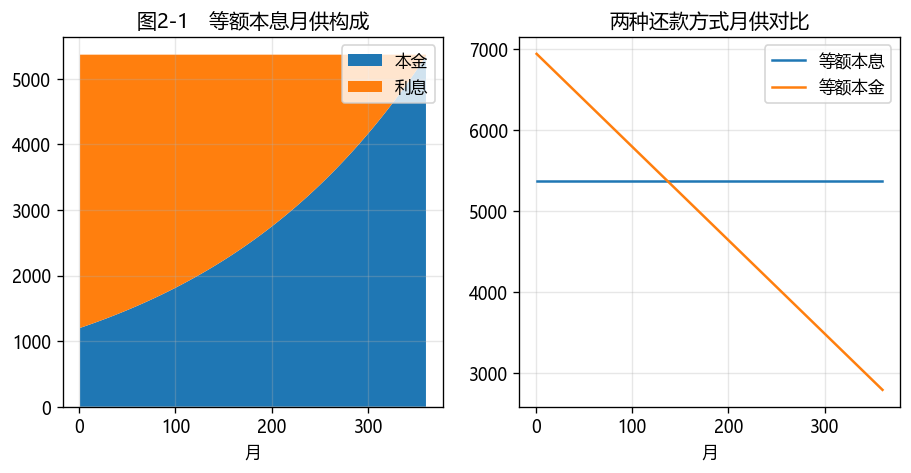

# 第2章　计息惯例、现金流与货币时间价值

[](https://mybinder.org/v2/gh/albertandking/fixed-income/main?labpath=notebooks/ch02_time_value.ipynb)

!!! info "配套代码"
    本章时间价值、计息惯例与应计利息均由 `fi.cashflow` 实现，并与 QuantLib 的 `DayCounter` 交叉验证；案例（房贷计算器、国债应计利息）可离线运行。

## 2.1 本章导读与学习目标

第3章将讨论债券定价，本章先介绍两类必要的基础工具。第一类是**货币时间价值**，即将不同时点的现金流换算到同一估值时点。第二类是**计息惯例（day-count convention）**与价格口径：相同的起止日期按不同惯例计算，所得计息期间和利息可能不同；债券按净价报价时，结算金额还需加上应计利息。掌握这些概念后，才能在后续章节中准确生成现金流并进行折现。

!!! abstract "学习目标"
    学完本章，读者应能：

    1. 掌握**现值、终值与年金**的离散复利公式，能够区分名义年利率与有效年利率，并用 Python 折现现金流；
    2. 用年金公式计算**等额本息还款额**（房贷计算器）；
    3. 说明主要**计息惯例**（ACT/ACT、ACT/365F、ACT/360、30/360）的差异，理解 ACT/ACT 子约定以及中国债券市场应计利息的常用口径；
    4. 区分**净价、全价与应计利息**，计算给定结算日的应计利息与全价；
    5. 用 `fi.cashflow` 与 QuantLib `Schedule`/`DayCounter` 两条路径计算并相互验证。

---

!!! note "本章知识结构"
    **现值 / 终值 / 折现**（2.2，定价的基石）→ **年金 / 等额本息**（2.3）
    　↓ 利息 = 本金 × 利率 × 计息时间
    **计息惯例**（2.4，ACT/ACT、ACT/365F、ACT/360、30/360）
    　↓ 成交价的两个口径
    **净价 / 全价 / 应计利息**（2.5）→ `fi.cashflow` 与 QuantLib `DayCounter` 实现（2.6–2.7）

## 2.2 现值、终值与折现

设年利率 $r$、每年复利 $k$ 次，则每期利率为 $r/k$，$t$ 年共 $kt$ 期。

**终值（Future Value）**——今天的 $PV$ 在 $t$ 年后变成：

$$FV=PV\left(1+\frac{r}{k}\right)^{kt}$$

**现值（Present Value）**——$t$ 年后的 $FV$ 折回今天：

$$\boxed{\;PV=\frac{FV}{\left(1+\dfrac{r}{k}\right)^{kt}}\;}$$

为什么需要区分不同时点的货币价值？如果资金现在可以按正利率投资，推迟收取同等金额就意味着放弃了期间可能获得的收益。这是货币时间价值的基本出发点。在名义金额的比较中，通货膨胀会影响未来资金的购买力；对存在不确定性的现金流，折现率还可能包含风险补偿。因此，需要区分基准利率、通胀预期与风险溢价，不宜将它们全部等同于"等待的价格"。

折现的作用，是将不同时点的现金流换算到同一估值日再进行比较或加总。对发生在 $t_i$ 时点的现金流 $CF_i$，若为了初步说明而假设各期共用常数折现率 $r$，其现值为 $\sum_i CF_i(1+r/k)^{-k t_i}$。实际定价时，不同到期日通常应使用相应期限的折现因子，第5章将对此进一步讨论。

!!! example "例2.1：终值与现值"
    年利率 5%、按年复利（$k=1$）：

    - 100 元 3 年后的终值：$FV=100\times1.05^{3}=115.7625$ 元；
    - 反过来，3 年后的 115.7625 元，今天的现值：$PV=115.7625/1.05^{3}=100.0000$ 元。
    
    在名义年利率 $r>0$ 且其他条件相同的情况下，复利次数 $k$ 越大，有效年利率和终值越高；这也是为什么比较利率必须说清复利频率。

### 2.2.1 名义年利率与有效年利率

当年利率 $r$ 是每年复利 $k$ 次的名义年利率时，实际一年期累计收益率，即**有效年利率**（effective annual rate, EAR），为：

$$\boxed{\;EAR=\left(1+\frac{r}{k}\right)^k-1\;}$$

例如，名义年利率为12%、按月复利时，有效年利率为 $(1+0.12/12)^{12}-1\approx12.68\%$。因此，比较两个利率前，必须先确认它们的报价周期、复利频率与计息惯例，必要时再换算到同一口径。

若采用连续复利，年化连续复利率为 $r_c$ 时，$FV=PV e^{r_c t}$，其与有效年利率的换算关系为 $EAR=e^{r_c}-1$。连续复利在理论模型中较常见，实际交易和合同计息则应以具体报价惯例为准。

---

## 2.3 年金与等额本息

**普通年金**指每期末等额支付。每期支付 $\text{pmt}$、共 $N$ 期、每期利率 $i=r/k$。把每期支付各自折现再相加：

$$PV=\sum_{j=1}^{N}\frac{\text{pmt}}{(1+i)^{j}}=\text{pmt}\sum_{j=1}^{N}(1+i)^{-j}$$

括号内是首项 $(1+i)^{-1}$、公比 $(1+i)^{-1}$ 的等比数列，求和得到**闭式解**：

$$\boxed{\;PV=\text{pmt}\cdot\frac{1-(1+i)^{-N}}{i}\;}$$

这个公式把"$N$ 笔等额现金流"压缩成一个表达式，避免逐笔累加——它是房贷、年金险、附息债票息部分定价（第3章年金法）的共同基石。

反过来，已知现值（如贷款本金）求每期还款额，就是**等额本息（等额年金）**：

$$\boxed{\;\text{pmt}=PV\cdot\frac{i}{1-(1+i)^{-N}}\;}$$

这正是房贷"等额本息"月供的计算公式。（"等额本金"则是每期偿还相同金额的本金，并支付按剩余本金计算的利息，因此每期还款额逐步下降。）

!!! example "例2.2：房贷月供"
    贷款 100 万元，期限 30 年，年利率 5%，按月还款（$k=12$，$N=360$，$i=0.05/12$）：

    $$\text{pmt}=1{,}000{,}000\times\frac{0.05/12}{1-(1+0.05/12)^{-360}}=5{,}368.22\text{ 元/月}$$
    
    按未四舍五入的精确月供计算，30年总还款约为 $1{,}932{,}557.84$ 元，其中利息约93.26万元。若直接用展示到分的月供 $5{,}368.22$ 元乘以360期，总还款为 $1{,}932{,}559.20$ 元，两者的微小差异来自月供数值的四舍五入。在利率不变且不考虑手续费的条件下，较长的还款期限会显著提高累计利息。

等额本息的每期还款额保持不变，但本金与利息的构成会随时间变化。利息按当期剩余本金计算，因此还款初期利息占比较高；随着剩余本金下降，每期利息减少，偿还本金的部分相应增加。图2-1展示了这一变化。提前还款能够减少后续利息，但是否具有经济上的优势，还应综合考虑提前还款费用、可替代投资收益、税收影响与流动性需求，不能仅根据"越早节省利息越多"作出判断。

---

## 2.4 计息惯例（Day Count Conventions）

利息金额通常由本金、年化利率与**计息期间的年化分数**共同决定。计息惯例（**day-count convention**）规定分子如何计算日数、分母如何确定年度或付息周期天数。同一起止日期在不同惯例下可能得到不同的年化分数。常见惯例如下：

| 惯例                 | 年化分数 =                                            | 用途                                     |
| ------------------ | ------------------------------------------------- | -------------------------------------- |
| **ACT/ACT (ISDA)** | 实际天数；跨公历年时分段计算，每段分母为该年365或366天                    | 利率衍生品和通用估值中的一种子约定                      |
| **ACT/ACT (ICMA)** | 规则付息期内为实际天数 / （参考付息周期实际天数 × 年付息频率）；不规则首尾期需按参考期间分段 | 许多固定利率债券的票息和应计利息计算[^icma-actact]       |
| **ACT/365F**       | 实际天数 / 365                                        | 部分货币市场和金融合约                            |
| **ACT/360**        | 实际天数 / 360                                        | 货币市场和部分浮动利率合约                          |
| **30/360**         | 按规则将每月视为30天、每年视为360天                              | 部分债券和利率衍生品；需进一步区分 30/360 US、30E/360 等子约定 |

!!! warning "ACT/ACT 和 30/360 都不是唯一算法"
    仅写"ACT/ACT"或"30/360"往往不足以唯一确定计算结果。ACT/ACT (ISDA) 按公历年拆分，ACT/ACT (ICMA) 依赖参考付息周期；30/360 US 与 30E/360 对月末日期的调整规则也不同。合同、程序与教材算例必须使用同一子约定。30/360 和 ACT/360 由历史上的市场报价与计算需要逐渐形成，以360为分母便于按月、季度和半年进行拆分，但这是合同约定，不表示一个公历年实际有360天。ISDA 已以《2021 ISDA Interest Rate Derivatives Definitions》更新利率衍生品定义文件。2021年定义自2021年10月4日起实施，主要中央对手方已将其纳入清算规则，非清算交易则逐步迁移。[^isda-2021]

!!! example "例2.3：同一区间在不同计息惯例下的年化分数"
    从 2026-03-15 到 2026-09-15，实际 184 天（2026 非闰年）：

    | 惯例 | 年化分数 |
    |---|---|
    | ACT/ACT (ISDA) | 0.504110 |
    | ACT/365F | 0.504110 |
    | ACT/360 | 0.511111 |
    | 30/360 | 0.500000 |
    
    本例中 ACT/ACT (ISDA) 与 ACT/365F 相等，因为整个区间位于同一非闰年内。若区间包含闰年的天数，ACT/ACT (ISDA) 对该年部分以366为分母，而 ACT/365F 始终以365为分母，两者会出现差异。若区间仅跨越两个均为非闰年的公历年边界，ACT/ACT (ISDA) 各段分母均为365，两者不会产生差异。

!!! warning "计息惯例是合同要素"
    计息惯例会直接影响利息、应计利息和估值结果。交易与程序实现时，应同时确认计息惯例、子约定以及起始日和终止日的计入规则（行业中称"算头不算尾"等）。

---

## 2.5 净价、全价与应计利息

债券在两个付息日之间结算时，发行人尚未支付当期票息，但卖方在持有期间已累积了部分利息。买方在结算时支付这部分**应计利息（accrued interest, AI）**，待下一付息日再收取完整的当期票息。不同市场、券种和业务规则采用的应计利息口径并不完全相同。以《中证指数有限公司债券指数计算与维护细则》为例，附息债券每百元面值的应计利息可写为：[^csi-accrued]

$$\text{AI}=\underbrace{\frac{C}{f}}_{\text{当期票息}}\times\frac{t}{TS}$$

其中，$C$ 为每百元面值的年利息，$f$ 为年付息次数（即付息频率，对应代码参数 `freq`；注意它与2.2节中表示每年复利次数的 $k$ 含义不同），$t$ 为起息日或上一付息日至结算日的实际天数，$TS$ 为当前付息周期的实际天数。日数的起止包含规则、不规则首尾期和特殊券种仍应以发行条款与市场规则为准。

!!! note "应计利息口径应与适用规则一致"
    上式是中证债券指数计算规则采用的口径。交易所成交结算、银行间市场业务、指数编制和估值核算所适用的具体规则可能存在差异，部分券种也可能采用按固定年度天数折算等方式。因此，实际计算时不能只依据券种名称推断公式，应同时核对发行文件、交易场所规则和结算口径。

于是有两个价格：

$$\boxed{\;P_{\text{全价（dirty）}}=P_{\text{净价（clean）}}+\text{AI}\;}$$

对实行净价交易的债券，市场按不含应计利息的净价报价和成交，并以"净价+应计利息"确定结算价格。[^net-price-rule] 这样可以减少付息周期内利息自然累积对报价曲线的影响，便于观察由市场利率和供求变化引起的价格波动。

!!! example "例2.4：国债应计利息"
    某国债面值 100、票面利率 3%、半年付息（$f=2$），上一付息日 2026-03-15、下一付息日 2026-09-15，结算日 2026-06-15。按当前付息周期的实际天数计算。

    - 当期票息：$100\times3\%/2=1.50$ 元；
    - 已计息 92 天，完整付息期 184 天；
    - **应计利息**：$1.50\times\dfrac{92}{184}=0.75$ 元。
    
    若该券净价报 99.50，则全价 = $99.50+0.75=100.25$，买方每百元面值实付 100.25 元。

---

## 2.6 Python 实现：`fi.cashflow`

```python
import datetime as dt
from fi import cashflow as cf

# 时间价值（例2.1）
cf.future_value(100, 0.05, years=3)            # 115.7625
cf.present_value(115.7625, 0.05, years=3)      # 100.0

# 房贷等额本息月供（例2.2）
cf.annuity_payment(1_000_000, 0.05, n_periods=360, freq=12)   # 5368.22

# 计息惯例（例2.3）
s, e = dt.date(2026, 3, 15), dt.date(2026, 9, 15)
cf.year_fraction(s, e, "ACT/ACT")   # 0.504110
cf.year_fraction(s, e, "30/360")    # 0.500000

# 应计利息（例2.4）
cf.accrued_interest(dt.date(2026, 6, 15), dt.date(2026, 3, 15), dt.date(2026, 9, 15),
                    coupon_rate=0.03, freq=2, face=100, convention="ACT/ACT")   # 0.75
```

`year_fraction` 中的 `ACT/ACT` 指 ACT/ACT (ISDA)，即按公历年分段计算，闰年部分以366为分母。`accrued_interest` 在 ACT 类惯例下按实际天数之比 $t/TS$ 折算当期票息（30/360 则按 30/360 计息天数之比），与上文中证债券指数规则及 ICMA Actual/Actual 的口径一致。在例2.4中，$t/TS=92/184$。应注意 $t/TS$ 并不等于两个 ACT/ACT (ISDA) 年化分数之比：后者按公历年分段，在付息期跨越闰年时会产生微小差异。

!!! warning "`fi.cashflow` 的实现边界"
    当前教学代码中的 30/360 是简化实现，不应将 `30/360US` 与 `30E/360` 视为在所有日期上完全相同。此外，`accrued_interest` 只处理规则付息期，未实现不规则首末期的参考期间分段。以跨闰年的规则付息期为例：票面利率3%、半年付息，付息期为2027-11-15至2028-05-15（$TS=182$ 天），结算日为2028-02-15（$t=92$ 天），按 $t/TS$ 口径 $AI=1.50\times92/182=0.758242$ 元，`fi.accrued_interest(..., convention="ACT/ACT")` 与 QuantLib `ActualActual(ISMA)` 的结果均为 0.758242 元；若改用两个 ACT/ACT (ISDA) 年化分数之比，则得 0.758766 元，相差约0.0005元/百元面值。涉及月末、2月末、跨年度、闰年或不规则付息期时，应使用明确的子约定和适用规则，并与 QuantLib、交易系统或登记结算数据复核。

---

## 2.7 QuantLib 实现：`Schedule` 与 `DayCounter`

QuantLib 用 `DayCounter` 表示计息惯例、`Schedule` 生成付息日序列，可与 `fi.cashflow` 验证：

```python
import QuantLib as ql

d1, d2 = ql.Date(15, 3, 2026), ql.Date(15, 9, 2026)
ql.ActualActual(ql.ActualActual.ISDA).yearFraction(d1, d2)   # 0.50411  ← 与 fi 一致
ql.Actual365Fixed().yearFraction(d1, d2)                     # 0.50411
ql.Thirty360(ql.Thirty360.USA).yearFraction(d1, d2)          # 0.5

# 生成半年付息的付息日序列（用 Unadjusted 保持名义付息日，便于与教科书应计对齐）
sched = ql.Schedule(ql.Date(15, 3, 2026), ql.Date(15, 3, 2029), ql.Period(ql.Semiannual),
                    ql.NullCalendar(), ql.Unadjusted, ql.Unadjusted,
                    ql.DateGeneration.Backward, False)
list(sched)   # [2026-03-15, 2026-09-15, 2027-03-15, ...]

bond = ql.FixedRateBond(0, 100.0, sched, [0.03], ql.ActualActual(ql.ActualActual.ISMA))
bond.accruedAmount(ql.Date(15, 6, 2026))   # 0.75；在本例规则付息期内与 fi 的结果一致
```

!!! tip "交叉验证中的两个注意事项：子约定与营业日调整"
    1. **ACT/ACT 子约定**：`ActualActual` 区分 ISDA、ISMA (ICMA) 等子约定，对跨年区间和不规则付息期的处理不同。上例中，`fi.cashflow` 使用 ISDA 口径，`FixedRateBond` 使用 ISMA (ICMA) 口径；二者得到相同的0.75，是因为该规则付息期内的比例恰好一致，不能据此认为两种子约定在所有情形下等价。进行一般性对比时，两端应使用同一子约定和同一付息日程。
    2. **营业日调整**：若用 `China(IB)` 日历 + `Following`，名义付息日 2026-03-15（周日）会被顺延到 03-16，付息期从 184 天变成 183 天，应计随之偏离教科书值。要复现"名义付息日"的应计，需用 `NullCalendar` + `Unadjusted`。定位这类差异本身就是很好的练习。

---

## 2.8 案例：房贷还款计算器与国债应计利息

配套 notebook 实现两个实用工具：

1. **房贷还款计算器**：输入贷款金额、年限、利率，输出等额本息月供与还款明细（本金/利息逐月拆分），并与**等额本金**方式对比总利息，观察等额本息在还款初期利息占比较高的特征。
2. **国债应计利息计算器**：输入面值、票面利率、付息频率、上一付息日、下一付息日与结算日，按明确的日数规则计算应计利息与全价，并与 QuantLib `bond.accruedAmount()` 比较。

<figure markdown>
  { width="760" }
  <figcaption>图2-1　左：等额本息月供的本金/利息构成；右：等额本金与等额本息的月供对比</figcaption>
</figure>

**要点**：

- 在贷款金额、利率和期限相同且不考虑其他费用的条件下，等额本金方式的累计利息通常低于等额本息方式，但具体选择仍取决于借款人的现金流状况和还款偏好。
- 净价将债券市场价格与应计利息分开展示，全价则对应包含应计利息的结算价格；计息区间含有闰年日数时，ACT/ACT (ISDA) 与 ACT/365F 的年化分数会出现差异。

---

## 2.9 习题与编程实验

**概念题**

1. 解释"货币时间价值"，并说明为什么比较两个利率必须说清复利频率。
2. ACT/ACT (ISDA) 与 ACT/365F 在什么情况下结果相同？什么情况下不同？ACT/ACT (ISDA) 与 ACT/ACT (ICMA) 的参考分母有何区别？
3. 净价与全价相差什么？为什么许多实行净价交易的境内债券采用"净价报价、全价结算"？是否所有债券都采用这一方式？

**计算题**

4. 年利率 4.9%、按月复利，存入 5 万元，10 年后的终值是多少？
5. 某国债面值100元、票面利率2.8%、每半年付息，上一付息日为2026-01-20，下一付息日为2026-07-20，结算日为2026-05-06。按当前付息周期的实际天数口径计算应计利息；若净价为101.20元，求全价。

**编程实验**

6. 用 `fi.cashflow` 写一个房贷计算器：给定金额/年限/利率，输出等额本息月供与逐月本金/利息明细，并画出"本金 vs 利息"的逐月构成图。
7. 用 `fi.cashflow.year_fraction` 复现例2.3，再取一段包含闰年日数的区间（如 2027-12-15 → 2028-06-15），比较 ACT/ACT (ISDA) 与 ACT/365F 的差异并解释。
8. 实现一个支持多种计息惯例的应计利息函数，选取一只真实国债与 QuantLib `bond.accruedAmount()` 计算结果进行核对，给出误差报告。

---

## 2.10 习题参考答案与详解

!!! tip "完整可运行解答 notebook"
    本节编程实验的**完整可运行代码**见 [`notebooks/solutions/ch02_solutions.ipynb`](https://github.com/albertandking/fixed-income/blob/main/notebooks/solutions/ch02_solutions.ipynb)（可在本地或通过 Binder 在线运行）。

!!! success "概念题 1"
    **货币时间价值**：在利率为正、风险和其他条件相同情况下，较早取得的资金可用于投资并获得收益，因此未来现金流需要**折现**至同一时点后进行比较和加总。
    比较两个利率必须说清**复利频率**，因为同一个名义年利率，复利越频繁、实际收益越高（如 12% 按月复利的实际年利率 ≈ 12.68% > 按年复利的 12%）。不指明频率的利率无法直接比较。

!!! success "概念题 2"
    - **ACT/ACT (ISDA) 与 ACT/365F**：区间全部位于非闰年时，两者都以365为分母，结果相同。区间含有闰年的日数时，ACT/ACT (ISDA) 对该年部分以366为分母，ACT/365F 则仍以365为分母。若区间仅跨越两个非闰年的年度边界，两者结果仍然相同。
    - **ACT/ACT (ISDA) 与 ACT/ACT (ICMA)**：前者以各公历年的实际天数为分母并分年加总；后者以参考付息周期的实际天数和年付息频率为基础，因而需要付息日程信息。

!!! success "概念题 3"
    **全价 = 净价 + 应计利息**。净价剔除了"自上次付息以来累积、尚未支付"的利息，便于观察市场利率、信用状况和供求变化所引起的价格变动；全价则包含应计利息。对实行净价交易的境内债券，申报和成交采用净价，结算价格为净价与应计利息之和。并非所有债券或转让情形都统一采用这一方式，例如部分实行全价交易的品种或特殊转让安排，应以交易场所规则为准。[^net-price-rule]

!!! success "计算题 4"
    按月复利，$k=12$、$n=10$ 年、$i=0.049/12$：

    $$FV=50000\times\left(1+\frac{0.049}{12}\right)^{120}=\mathbf{81{,}534.42}\text{ 元}$$
    
    （用 `fi.cashflow.future_value(50000, 0.049, 10, freq=12)` 验证。）

!!! success "计算题 5"
    当期票息 $=100\times2.8\%/2=1.40$ 元。从上一付息日2026-01-20到结算日2026-05-06实际为 **106天**，整个付息期2026-01-20至2026-07-20实际为 **181天**：

    $$\text{应计利息}=1.40\times\frac{106}{181}=\mathbf{0.8199}\text{ 元},\qquad \text{全价}=101.20+0.8199=\mathbf{102.0199}$$
    
    （用 `fi.cashflow.accrued_interest(...)` 验证。）

!!! success "编程实验 6–8（要点）"
    - **实验 6**：用 `annuity_payment` 求月供，逐月 `利息=余额×i`、`本金=月供−利息`、`余额−=本金`；构成图见图2-1，其中还款初期的利息占比较高。
    - **实验 7**：按当前 `fi.cashflow` 的 ACT/ACT (ISDA) 实现，`year_fraction(2027-12-15, 2028-06-15, "ACT/ACT")` ≈ **0.500127**，`"ACT/365F"` ≈ **0.501370**。区间包含闰年2028年的日数，前者对该部分以366为分母，因而与 ACT/365F 出现差异。
    - **实验 8**：先根据所选债券的发行文件和适用市场规则确定应计公式，再与 QuantLib `bond.accruedAmount()` 对比。`fi.cashflow.accrued_interest` 在 ACT 类惯例下采用 $t/TS$ 口径，仅适用于规则付息期；同时用 `NullCalendar`+`Unadjusted` 控制营业日调整，并对齐 ActualActual 子约定，否则可能出现并非程序错误的口径差异。

---

## 2.11 本章小结

- **货币时间价值**是折现的基石：$PV=FV(1+r/k)^{-kt}$；一串现金流的现值就是逐笔折现之和（第3章定价的来源）。
- **年金**公式把等额现金流与现值连起来；等额本息月供 $=PV\cdot i/[1-(1+i)^{-N}]$。
- **计息惯例**决定计息期间的年化分数。ACT/ACT 和 30/360 都存在不同子约定，必须结合合同、发行条款和付息日程确定具体算法。
- 对实行净价交易的债券，通常以**净价报价和成交**，以净价加应计利息形成**结算全价**；具体应计利息公式和日期包含规则应以发行文件及适用业务规则为准。
- 本章给定的规则付息算例中，`fi.cashflow` 可与 QuantLib `DayCounter`/`Schedule` 进行结果比较；若要获得可比结果，必须对齐 ACT/ACT 子约定、付息日程、营业日调整和应计利息口径。代码实现的适用范围见2.6节的说明。

!!! note "知识点自测清单"
    - [ ] 默写并计算**现值 / 终值 / 年金**公式
    - [ ] 解释为什么比较两个利率必须说清**复利频率**
    - [ ] 用年金公式算**等额本息月供**
    - [ ] 说出 ACT/ACT (ISDA)、ACT/ACT (ICMA)、ACT/365F、ACT/360 与 30/360 的主要区别
    - [ ] 解释 ACT/ACT (ISDA) 与 ACT/365F 何时相同、何时不同
    - [ ] 计算给定结算日的**应计利息**与全价
    - [ ] 解释"净价报价、全价结算"及其适用边界

!!! quote "资料来源与延伸阅读"
    - Tuckman & Serrat, *Fixed Income Securities*，关于现金流、计息惯例与应计利息的章节；
    - 中证指数有限公司：《中证指数有限公司债券指数计算与维护细则》，关于附息债券应计利息的计算规则；
    - 上海证券交易所：《债券净价交易投资者问答》，关于净价交易与全价结算的说明；
    - ICMA, *Appendix A5: Day Count Fraction—ICMA Actual/Actual*，债券市场 Actual/Actual (ICMA) 的计算说明；
    - ISDA, *2021 ISDA Interest Rate Derivatives Definitions*，利率衍生品计息惯例的现行定义框架。

[^icma-actact]: International Capital Market Association: [*ICMA Primary Market Handbook, Appendix A5: Day Count Fraction—ICMA Actual/Actual*](https://www.icmagroup.org/assets/documents/ICMA-PMH-Appendix-A5-March-2022.pdf), March 2022.

[^isda-2021]: International Swaps and Derivatives Association: [*2021 ISDA Interest Rate Derivatives Definitions*](https://www.isda.org/book/2021-isda-interest-rate-derivatives-definitions/). ISDA说明2021年定义是对2006年定义的更新。另见 ISDA: [*Landmark Change in Interest Rate Derivatives Market as New Definitions Take Effect*](https://www.isda.org/a/arigE/Landmark-Change-in-Interest-Rate-Derivatives-Market-as-New-Definitions-Take-Effect.pdf), October 4, 2021：2021年定义自当日实施，多数主要中央对手方同步将其纳入清算规则，ISDA自该日起不再更新2006年定义。

[^csi-accrued]: 中证指数有限公司：[《中证指数有限公司债券指数计算与维护细则》](https://oss-ch.csindex.com.cn/notice/20251231114335-%E9%99%84%E4%BB%B61%20%E3%80%8A%E4%B8%AD%E8%AF%81%E6%8C%87%E6%95%B0%E6%9C%89%E9%99%90%E5%85%AC%E5%8F%B8%E5%80%BA%E5%88%B8%E6%8C%87%E6%95%B0%E8%AE%A1%E7%AE%97%E4%B8%8E%E7%BB%B4%E6%8A%A4%E7%BB%86%E5%88%99%E3%80%8B.pdf)（V4.0，2025年12月），附息债券按 $AI=(C/f)\times(t/TS)$ 计算。

[^net-price-rule]: 上海证券交易所：[《关于发布施行〈上海证券交易所债券交易规则〉及有关事项的通知》](http://www.sse.com.cn/lawandrules/sselawsrules2025/bond/trading/currency/c/c_20250604_10780834.shtml)（上证发〔2022〕24号），2022年1月27日，规则第五十六条规定债券现券交易采用净价申报，另有规定的除外；通知明确次级档资产支持证券、可转债及特定债券采用全价申报。净价交易、全价结算的含义另见上海证券交易所：[《上海证券交易所债券净价交易投资者问答》](https://www.sse.com.cn/aboutus/mediacenter/hotandd/c/c_20150912_3988250.shtml)。

下一章（第3章）将综合运用上述两项基础工具：用时间价值折现、按惯例处理应计，给中国国债与国开债**定价**。
