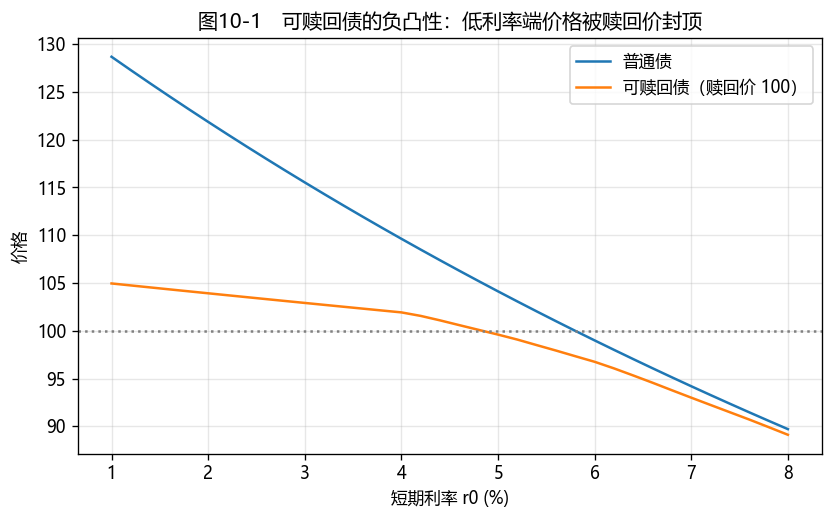

# 第9章　可赎回债券与可回售债券

[](https://colab.research.google.com/github/albertandking/fixed-income/blob/main/notebooks/ch09_callable_putable.ipynb) [](https://mybinder.org/v2/gh/albertandking/fixed-income/main?labpath=notebooks/ch09_callable_putable.ipynb)

!!! info "配套代码与阅读说明"
    本章用 `fi.tree` 演示利率树、含权债定价和有效久期/凸性，并用 QuantLib 的 `CallableFixedRateBond` 和 Hull–White 树引擎说明工程实现。`fi.tree` 是教学用简化模型，未校准市场零息曲线；本章的示例数值不应直接用于交易或会计估值。

## 9.1 本章导读与学习目标

普通固定利率债券的合同现金流在无违约前提下可以事先确定。可赎回债和可回售债则不同：当合同约定的条件满足时，发行人或投资者可以提前结束债券。因此，现金流的金额和时间取决于未来利率、信用状况、合同条款及行权决策。

这并不意味着"折现"失效，而是说：**按一条预先确定的现金流表逐笔折现已不够**。估值时必须同时描述利率的可能路径和每条路径上的最优行权行为。利率树与反向归纳法为此提供了直观框架。

!!! abstract "学习目标"
    学完本章，读者应能：

    1. 辨明可赎回权和可回售权的归属，并用"普通债 ± 期权"分解含权债价值；
    2. 说明可赎回债为何可能出现局部负凸性和久期压缩；
    3. 在明确行权时点和价格口径的前提下，用利率树和反向归纳法定价；
    4. 定义期权调整利差（OAS），并识别其模型依赖性；
    5. 使用 `fi.tree` 和 QuantLib 进行可复核的教学实验。

!!! note "本章知识结构"
    **期权归属与价值分解**（9.2）
    → **价格曲线、久期与凸性**（9.3）
    → **利率树与反向归纳**（9.4）
    → **OAS 与模型风险**（9.5）
    → **Python/QuantLib 实现与中国市场应用**（9.6–9.8）

---

## 9.2 嵌入期权的债券：谁持有期权？

### 9.2.1 可赎回债（callable bond）

可赎回债允许**发行人**在约定日期以约定价格提前偿还债券。其经济价值可写为：

$$
\boxed{V_{\text{可赎回债}}=V_{\text{同条件普通债}}-V_{\text{发行人赎回权}}}
$$

当利率下降且再融资节约足以覆盖交易成本、赎回溢价和合同限制时，发行人更可能行权。从投资者角度看，这相当于持有普通债的同时向发行人卖出一份赎回期权。所以，在发行人、偿付顺序、期限、流动性和税务等其他条件相同时，可赎回债的价值通常低于普通债，发行时往往需要通过较高票息或较有利的发行价格补偿投资者。

这一机制可类比为房贷的提前还款：借款人以 5% 签下房贷，若市场利率降至 3%，便可提前结清旧贷、以更低成本再借，相当于"赎回"了高息债务。可赎回债的发行人处境相同，赎回权是其持有的再融资期权；在其他条件相同时，投资者以接受更高利息为对价卖出这份权利。

!!! warning "“收益率更高”并非无条件成立"
    到期收益率默认债券持有到期，对可能被提前赎回的债券容易产生误导。实务中还会参考赎回收益率（yield to call）、最差收益率（yield to worst）和 OAS。

### 9.2.2 可回售债（putable bond）

可回售债允许**投资者**在约定日期以约定价格将债券卖回给发行人：

$$
\boxed{V_{\text{可回售债}}=V_{\text{同条件普通债}}+V_{\text{投资者回售权}}}
$$

利率上升、信用状况恶化或合同约定的其他事件发生时，回售权可以限制投资者的下行风险。在其他条件相同时，可回售债通常比普通债更贵；投资者通过接受较低票息或较高价格为该保护付费。

### 9.2.3 条款细节决定期权价值

"可赎回"或"可回售"只是标签，不是完整的估值输入。至少应核对：

- 行权日期是单一日期、多个离散日期（Bermudan），还是一段连续期间（American）；
- 赎回/回售价格是净价还是全价，是否包含当期票息、应计利息或赎回溢价；
- 行权发生在付息前还是付息后，通知期多长；
- 是否存在票面利率调整权、交叉违约条款、监管批准条件或减记/转股条款；
- 赎回权与回售权在同一日期并存时，合同规定的行权先后顺序是什么。

!!! note "中国市场的“X+Y”结构"
    中国信用债中常见"3+2"等结构：债券的法定到期日可能在第 5 年，但投资者在第 3 年末可以回售，发行人同时可能拥有调整后续票面利率的权利。这类条款形成相互作用的选择权，但回售决策还受信用、流动性、融资需求等因素影响，不能简化为"票息不上调就一定回售"。王冰山、刘家祺（2024）对 2015 年至 2023 年 6 月银行间市场已行权含权债的统计也表明，利率调整水平并非行权结果的主导因素，投资集中度限制、操作风险、发行人信用状况、信息基础设施及主承销商沟通协调等因素均会影响行权。

    非金融企业永续类债务融资工具还可能设置发行人赎回权和票息跳升机制；估值时需同时考虑条款设计、发行人融资能力及市场定价。

!!! warning "监管资本工具不能只按普通赎回期权理解"
    银行其他一级资本工具和二级资本工具可能包含赎回、减记或转股条款，赎回还可能需监管批准。这些条款的风险来源超出单纯利率期权，应以募集说明书和当时适用的监管规则为准。

---

## 9.3 价格、久期与凸性

### 9.3.1 可赎回债的局部负凸性

当利率较高时，发行人通常没有动机用高成本新债替换低成本旧债，可赎回债的价格趋近同条件普通债。当利率降低、赎回权逐渐进入价内时，普通债的价格仍会随利率下行而上升，可赎回债的上涨空间则被行权可能性压缩。

因而，可赎回债的价格—利率曲线在行权边界附近可能呈现**局部负凸性**：利率下降带来的价格上涨小于对称幅度利率上升造成的价格下跌。负凸性不一定覆盖整个低利率区间；它的位置和程度取决于赎回日程、赎回价、票息、曲线形状和波动率。

"赎回价封顶"是有用的直觉，但不应按字面理解。在赎回日到来之前，债券价格还包含期间票息、时间价值和应计利息，净价或全价均可能暂时高于合同所列的赎回价。

可回售债的情形与此相反：回售价在利率上升时为价格提供托底，使其凸性较同条件普通债更强。

<figure markdown>
  { width="640" }
  <figcaption>图9-1　教学模型中的普通债与可赎回债价格—利率曲线：利率下行时，可赎回债的上涨空间受到赎回权压制，呈现局部负凸性</figcaption>
</figure>

### 9.3.2 有效久期与有效凸性

修正久期把现金流日程视为固定，因此不能完整反映利率变动对行权决策的影响。对含权债，通常在利率曲线整体上移和下移后重新估值，并允许每个节点的行权决策随之改变：

$$
D_{\mathrm{eff}}=\frac{P_{-}-P_{+}}{2P_0\Delta y},
\qquad
C_{\mathrm{eff}}=\frac{P_{-}+P_{+}-2P_0}{P_0(\Delta y)^2}.
$$

其中，$P_{-}$、$P_0$、$P_{+}$ 分别是曲线下移、不变和上移后的模型价格。三个价格必须使用一致的净价或全价口径，$\Delta y$ 的单位也必须一致。例9.2（9.4.4）中，普通债有效久期约 5.3 年，加入赎回权后压缩到约 1.0 年。

!!! note "“有效久期”不是唯一的风险度量"
    平行移动只是一种压力方式。实务风控还会考察关键利率久期、OAS 久期、曲线陡峭度/弯曲度变动以及波动率敏感性。在行权边界附近，价格函数可能出现折点，数值凸性对 bump 幅度尤其敏感。

---

## 9.4 利率树与反向归纳

### 9.4.1 从教学树到无套利利率树

利率树把未来短期利率表示为一组可能节点。在风险中性定价下，后续价值按风险中性概率取期望，再用节点利率折现。但"上、下分支概率各为 0.5"只是某些对称树的具体设定，不是利率二叉树的普遍定律。

可用于市场估值的树通常需要校准当前零息曲线，并使模型重现指定的波动率信息。Black–Derman–Toy 模型的原始论文（Black, Derman & Toy, 1990）展示了如何由当前期限结构和波动率构造短利率树；Hull–White 模型（Hull & White, 1990）则以可与当前期限结构拟合的均值回归短利率过程为基础。

### 9.4.2 反向归纳与行权时点

设节点 $(i,j)$ 的上行概率为 $q_{i,j}$，时间步长为 $\Delta t$，下期两个节点的价值为 $V^u$、$V^d$。若下一时点支付票息 $C_{i+1}$，用单利折现的教学写法为：

$$
V^{\mathrm{cont}}_{i,j}
=
\frac{C_{i+1}+q_{i,j}V^u+(1-q_{i,j})V^d}
{1+r_{i,j}\Delta t}.
$$

实际模型也可采用连续复利折现因子 $e^{-r_{i,j}\Delta t}$。在可行权节点，若赎回/回售价格与续作价值均按"付息后"口径计量，则：

$$
V^{\mathrm{call}}_{i,j}=\min\!\left(V^{\mathrm{cont}}_{i,j},K^{\mathrm{call}}_i\right),
$$

$$
V^{\mathrm{put}}_{i,j}=\max\!\left(V^{\mathrm{cont}}_{i,j},K^{\mathrm{put}}_i\right).
$$

若行权日与付息日重合，必须先确定票息是在比较之前还是之后支付；否则会把票息重复计入或漏掉。同一节点同时存在赎回权和回售权时，还必须按合同的行权顺序处理，不能无条件地先取 `min` 再取 `max`。

### 9.4.3 两期手算例：行权时点与票息口径

!!! example "例9.1：两期手算——行权时点与票息口径"
    考虑一只面值 100、年票息 5、剩余两年的债券。设 $r_0=4\%$，第 1 年末的短期利率为 6% 或 3%，风险中性概率各为 0.5。发行人可在第 1 年票息支付后以 100 赎回。

    第 1 年末的付息后续作价值为：

    $$
    V_u^{\mathrm{cont}}=\frac{105}{1.06}=99.0566,
    \qquad
    V_d^{\mathrm{cont}}=\frac{105}{1.03}=101.9417.
    $$

    因此上行节点不赎回，下行节点赎回；可赎回债在两个节点的付息后价值分别为 99.0566 和 100。期初价值为：

    $$
    V_0^{\mathrm{call}}
    =\frac{5+0.5\times99.0566+0.5\times100}{1.04}
    =100.5080.
    $$

    同条件普通债价值为 101.4415，因而在这一简化模型中，赎回权价值为 $101.4415-100.5080=0.9335$。

### 9.4.4 配套模型示例

本书配套代码 `fi.tree` 采用对数正态教学树进行反向归纳，默认上行概率为 0.5，可复算出下列结果（例9.1 的手算结果亦可由 `value_bond` 复现）：

| 示例 | 普通债价格 | 含权债价格 | 期权价值 | 普通债有效久期 | 含权债有效久期 |
|---|---:|---:|---:|---:|---:|
| 例9.2：6 年、票息 6、$r_0=3\%$、$\sigma=20\%$、第 1 步起可按 100 赎回 | 115.5203 | 102.9126 | 12.6076 | 5.2888 | 0.9709 |
| 例9.3：6 年、票息 2、$r_0=5\%$、$\sigma=20\%$、第 1 步起可按 100 回售 | 83.9059 | 97.1429 | 13.2370 | 5.5452 | 0.9524 |

例9.2 中，可赎回债比同条件普通债低约 12.6 元，即投资者卖出赎回权所让渡的价值；由于低利率环境下赎回很可能发生，其有效久期由约 5.3 年压缩到约 1.0 年。例9.3 中，回售权为深度折价的普通债提供了托底，价格被拉近回售价，有效久期也缩短到约 1 年。

!!! warning "这些是教学模型输出，不是市场估值"
    该教学树围绕 $r_0$ 按固定公式生成，没有拟合一条完整的市场零息曲线。数值可用来验证程序和理解机制，不能被解读为真实债券的公允价值。

---

## 9.5 期权调整利差（OAS）

### 9.5.1 定义

期权调整利差（option-adjusted spread, OAS）是加在基准利率树或相应折现因子上的一个利差 $s$，使模型价格与观察到的市场价格相等：

$$
\text{求 }s:\qquad
V_{\text{模型}}(\text{基准曲线},s,\text{波动率},\text{行权规则})
=P_{\text{市场}}.
$$

OAS 的意义是在模型内先为嵌入期权定价，再把剩余价格差异表示为利差。因此，它比直接比较到期收益率更适合用于含权债的横向比较。

### 9.5.2 OAS 不等于"纯信用利差"

OAS 常被解读为扣除期权影响后的信用与流动性补偿，但这是一种**模型内解读**。实际残差还可能吸收：

- 利率模型、波动率或行权行为设定的误差；
- 基准曲线选择、资金成本和流动性溢价；
- 税务、供需、结算及报价口径差异；
- 市场价格噪声。

因此，两个 OAS 只有在基准曲线、利率模型、波动率、信用假设、行权日程和价格口径可比时才适合直接比较。

### 9.5.3 波动率敏感性

在市场价格和其他模型输入保持不变时，提高波动率通常会提高嵌入期权价值：

- **可赎回债**：发行人持有的赎回权更值钱，债券模型价值更低；为了匹配同一市场价格，求得的 OAS 通常下降。
- **可回售债**：投资者持有的回售权更值钱，债券模型价值更高；为了匹配同一市场价格，求得的 OAS 通常上升。

"通常"是重要限定。复杂的曲线变动、多重期权、信用—利率相关性或非最优行权行为可能改变简单单调关系。

---

## 9.6 Python 实现：`fi.tree`

```python
from fi import tree

# 教学用对数正态短利率树：未校准市场曲线
t = tree.short_rate_tree(r0=0.03, sigma=0.20, n_steps=6)

# 例9.2：普通债与可赎回债
straight = tree.value_bond(t, coupon=6.0, face=100)
callable_ = tree.value_bond(
    t,
    coupon=6.0,
    face=100,
    call_price=100,
    call_from=1,
)
call_value = straight - callable_

# 有效久期/有效凸性：利率树整体平移后重新定价
# 两者均取与例9.2 相同的 r0=0.03，保证与上面的价格属同一情形
duration = tree.effective_duration_tree(
    0.03, 0.20, 6, 6.0, call_price=100, call_from=1
)
convexity = tree.effective_convexity_tree(
    0.03, 0.20, 6, 6.0, call_price=100, call_from=1
)

print(straight, callable_, call_value, duration, convexity)
```

`value_bond` 在每个可行权节点比较付息后的续作价值与行权价格（与例9.1 的口径相同），先取 `min`（赎回）再取 `max`（回售）。这一时点约定是本书配套代码 `fi` 的简化设定，正文、notebook 与代码保持一致；不应把它直接套用到具有不同付息/行权时序的真实合同。

---

## 9.7 QuantLib 实现：`CallableFixedRateBond`

QuantLib 的 `CallableFixedRateBond` 支持离散赎回/回售日程，`TreeCallableFixedRateBondEngine` 可与 Hull–White 等短利率模型配合使用。类接口还提供 `OAS`、`cleanPriceOAS`、`effectiveDuration` 和 `effectiveConvexity` 等方法。

```python
import QuantLib as ql

today = ql.Date(15, 6, 2026)
ql.Settings.instance().evaluationDate = today

day_count = ql.ActualActual(ql.ActualActual.ISDA)
curve = ql.YieldTermStructureHandle(
    ql.FlatForward(today, 0.03, day_count)
)
schedule = ql.Schedule(
    today,
    today + ql.Period(6, ql.Years),
    ql.Period(ql.Annual),
    ql.NullCalendar(),
    ql.Unadjusted,
    ql.Unadjusted,
    ql.DateGeneration.Backward,
    False,
)

call_schedule = ql.CallabilitySchedule()
for year in range(1, 6):
    call_schedule.append(
        ql.Callability(
            ql.BondPrice(100.0, ql.BondPrice.Clean),
            ql.Callability.Call,
            today + ql.Period(year, ql.Years),
        )
    )

bond = ql.CallableFixedRateBond(
    0, 100.0, schedule, [0.06], day_count,
    ql.Unadjusted, 100.0, today, call_schedule
)

# 以 sigma=0.015 的 Hull–White 模型价格作为固定的示例“市价”
base_sigma = 0.015
bond.setPricingEngine(
    ql.TreeCallableFixedRateBondEngine(
        ql.HullWhite(curve, 0.03, base_sigma), 100
    )
)
market_clean_price = bond.cleanPrice()

# 保持上述价格不变，仅改变模型 sigma，比较 OAS
for sigma in (0.005, 0.015, 0.030):
    bond.setPricingEngine(
        ql.TreeCallableFixedRateBondEngine(
            ql.HullWhite(curve, 0.03, sigma), 100
        )
    )
    oas_bp = bond.OAS(
        market_clean_price,
        curve,
        day_count,
        ql.Compounded,
        ql.Annual,
        bond.settlementDate(),
        1.0e-10,
        200,
        0.0,
    ) * 1.0e4
    print(f"sigma={sigma:.3%}, OAS={oas_bp:.2f} bp")
```

以 QuantLib 1.42.1 运行上述代码，可赎回债净价约为 102.69，与 `fi.tree` 的 102.91 属同一量级（两者模型不同，故有差异）；固定该价格后，$\sigma$ 取 0.5%、1.5%、3% 时求得的 OAS 约为 +17 bp、0 bp、−105 bp，即波动率上升时可赎回债的 OAS 下降。依 QuantLib 版本不同，上述数值可能有细微差异。

!!! warning "比较模型时先统一参数含义"
    `fi.tree` 中的 `sigma=20%` 是短利率对数树的乘法波动参数；Hull–White 中的 `sigma=0.015` 是高斯短利率过程的绝对波动参数。二者不能仅因都叫 `sigma` 就直接比较。两套模型的绝对价格会有差异，但定性结论一致：可赎回债价格受赎回权压制、久期被压缩、低利率端呈现负凸性。QuantLib 的具体输出还可能随版本、日历、网格密度和价格口径变化，记录结果时应同时注明运行环境，而不宜把某一版本的结果视为通用常数。

---

## 9.8 中国含权债分析框架

分析"X+Y"债、永续债或银行资本债时，可按下列顺序建立估值记录：

1. **还原条款**：列出所有付息日、行权日、通知期、赎回/回售价、票息调整规则和行权先后顺序。
2. **区分风险来源**：分开利率期权、信用迁徙、流动性、减记/转股和监管批准风险。
3. **选择并校准模型**：记录基准曲线、波动率、信用利差处理、恢复率及模型校准日期。
4. **建模行权行为**：理性行权是基准假设，但真实发行人和投资者还受融资约束、交易成本、声誉和制度安排影响。
5. **进行多维压力测试**：同时检查曲线、波动率、信用利差、行权偏差和流动性冲击，而不宜仅报告单一的 OAS 数值。
6. **保留可复核信息**：保存数据日期、源代码版本、运行环境、输入参数和净价/全价口径。

!!! tip "实务上先读条款，再选模型"
    含权债估值的大部分严重错误并非来自求解器，而是来自错读行权日、忽略票息调整、混用净价与全价，或把监管资本条款当作普通公司债条款。

---

## 9.9 习题与编程实验

**概念题**

1. 分别用"普通债 ± 期权"表示可赎回债和可回售债，说明谁持有期权、谁为期权付费。
2. 为什么"可赎回债价格不会高于赎回价"不是严格正确的表述？
3. 可赎回债的负凸性为何通常是局部现象？哪些参数会改变负凸性区间？
4. 修正久期与有效久期的核心差异是什么？
5. OAS 为什么不是可直接观测的"纯信用利差"？
6. 在其他输入不变时，提高波动率对可赎回债和可回售债的 OAS 通常有何不同影响？

**计算题**

7. 复算例9.1（9.4.3）的两期手算例，并解释票息 5 为什么在期初定价式中只出现一次。
8. 某同一校准模型给出同条件普通债价值 115、可赎回债价值 102，求模型内赎回期权价值。若 102 是市场价而 115 是模型价，还能否作出同样解释？

**编程实验**

9. 用 `fi.tree` 复现例9.2和例9.3，检查输出是否与9.4.4所列数值一致；并复现图9-1（可赎回债与普通债的价格—利率曲线），指出负凸性出现的区域。
10. 对 $r_0$ 进行扫描，用至少三种 `dy` 计算有效凸性，观察行权边界附近的结果对 bump 是否稳定。
11. 运行9.7的 QuantLib 示例，记录 QuantLib 版本、网格步数、模型价格和三个 OAS 结果；将网格步数加密后检查数值收敛性。

---

## 9.10 习题参考答案与详解

!!! tip "完整可运行解答 notebook"
    本节编程实验的**完整可运行代码**见 [`notebooks/solutions/ch09_solutions.ipynb`](https://colab.research.google.com/github/albertandking/fixed-income/blob/main/notebooks/solutions/ch09_solutions.ipynb)（点击徽章可在 Colab 直接运行）。

!!! success "概念题 1"
    可赎回债 = 同条件普通债 − 发行人赎回权。发行人持有期权，投资者卖出期权并要求补偿。可回售债 = 同条件普通债 + 投资者回售权。投资者持有期权，通过更高价格或更低票息为保护付费。

!!! success "概念题 2"
    赎回价只在特定行权日、按合同定义的净价/全价口径发生作用。在赎回日之前，债券还包含期间票息、应计利息和时间价值，因而市场价格可能高于合同赎回价。

!!! success "概念题 3"
    负凸性往往在赎回权从价外转为价内的区域最明显。利率很高时，期权价值很小，债券更像普通债；利率很低且赎回几乎确定时，价格又可能接近短期赎回现金流的折现值。票息、赎回价和日程、曲线形状及波动率都会改变该区间。

!!! success "概念题 4"
    修正久期假定现金流日程不随利率变化；有效久期在曲线变动后重新定价，并重新决定是否行权。

!!! success "概念题 5"
    OAS 是在指定基准曲线、利率模型、波动率和行权规则下解出的残差。模型误差、流动性、供需、税务和价格噪声都可能进入这一残差，所以 OAS 不是可观测、与模型无关的纯信用利差。

!!! success "概念题 6"
    在市场价格和其他输入不变时，提高波动率通常使可赎回债的 OAS 下降，使可回售债的 OAS 上升。对复杂条款应以实际模型重新估值为准。

!!! success "计算题 7"
    第 1 年末先收到票息 5，再比较付息后续作价值与赎回价 100。因此，续作价值只包含第 2 年的 105，期初折现式再单独加上第 1 年票息 5，不应在行权价中重复计入。计算结果见例9.1：$V_0^{\mathrm{call}}=100.5080$，普通债 101.4415，赎回权价值 0.9335。

!!! success "计算题 8"
    若 115 和 102 均由同一校准模型、一致利差假设产生，赎回期权模型价值为 $115-102=13$。若 102 是市场价而 115 是模型价，差额还混入了 OAS、流动性、模型误差和报价噪声，不能全部解释为赎回期权价值。

!!! success "编程实验 9–11（验收要点）"
    - **实验9**：例9.2 普通债 115.5203、可赎回债 102.9126、赎回权 12.6076，有效久期 5.2888 / 0.9709；例9.3 普通债 83.9059、可回售债 97.1429、回售权 13.2370。图9-1 中，可赎回债曲线在低利率端明显低于普通债并趋于平缓，即负凸性区域。若数值不一致，先核对 `fi.tree` 的版本和默认 `dy`。
    - **实验10**：行权边界附近的有效凸性对 `dy` 非常敏感。例如 `dy=1e-4` 时，$r_0$ 取 2%–8% 的有效凸性均为正；`dy=1e-3` 时，$r_0=4\%$、$6\%$ 处却出现绝对值很大的负值。因此报告时应同时给出 bump 幅度，而不宜只给出"由正转负的唯一区间"。
    - **实验11**：在 QuantLib 1.42.1、网格 100 步下，模型净价约 102.69，$\sigma$ 取 0.5%/1.5%/3% 时 OAS 约为 +17/0/−105 bp：基准 $\sigma=1.5\%$ 时"市价"由同一模型生成，OAS 为 0；波动率上升时 OAS 下降。网格加密到 400 步后结果变化在 1 bp 以内。依 QuantLib 版本不同可能有细微差异。

---

## 9.11 本章小结

- **可赎回债 = 同条件普通债 − 发行人赎回权**；**可回售债 = 同条件普通债 + 投资者回售权**。
- 可赎回债在行权边界附近可能出现局部负凸性和久期压缩；赎回价是有用的"封顶"直觉，但不是所有时点和价格口径下的硬上限。
- 利率树定价必须明确风险中性概率、折现方式、付息/行权时序和合同先后顺序。
- OAS 有助于在模型内分离期权影响，但它依赖曲线、模型、波动率和行权假设，不是无模型的纯信用利差。
- `fi.tree` 适合解释机制和验证程序；市场估值需要经校准的曲线与波动率、完整合同条款和可复核的运行环境。

下一章（第10章）将讨论可转换债券。可转债同时包含债权现金流、转股权及常见的赎回/回售条款，对状态变量和行权顺序的处理更为复杂。

!!! note "知识点自测清单"
    - [ ] 能在"其他条件相同"的前提下分解可赎回债与可回售债
    - [ ] 能区分赎回价直觉与严格价格上限
    - [ ] 能说明负凸性为何是局部现象
    - [ ] 能正确写出有效久期/凸性公式并说明重新行权的必要性
    - [ ] 能在反向归纳中正确处理票息与行权价格的时点
    - [ ] 能说明 OAS 的模型依赖性和波动率敏感性
    - [ ] 能从中国含权债条款中分离利率、信用、流动性和监管风险

!!! quote "延伸阅读"
    - Fabozzi, *Bond Markets, Analysis, and Strategies*，"Analysis of Bonds with Embedded Options" 与 "Valuing Bonds with Embedded Options / OAS" 章节；
    - Tuckman & Serrat, *Fixed Income Securities*，关于二叉树模型与含权债的章节；
    - Black, F., Derman, E. & Toy, W. (1990). A one-factor model of interest rates and its application to Treasury bond options. *Financial Analysts Journal*, 46(1), 33–39. <https://doi.org/10.2469/faj.v46.n1.33>（BDT 模型原始文献）
    - Hull, J. & White, A. (1990). Pricing interest-rate-derivative securities. *The Review of Financial Studies*, 3(4), 573–592. <https://doi.org/10.1093/rfs/3.4.573>（Hull–White 模型原始文献）
    - QuantLib [`CallableFixedRateBond` 接口](https://quantlib-python-docs.readthedocs.io/en/latest/instruments/bonds.html#callable-bond)与 [QuantLib-Python 债券定价引擎文档](https://quantlib-python-docs.readthedocs.io/en/latest/pricing_engines/bonds.html)；
    - 王冰山、刘家祺（2024）.《并非唯"利"是图：多因素影响下的含权债行权》.《金融市场研究》2024 年第 4 期（总第 143 期），21–30.（[全文 PDF](https://www.nafmii.org.cn/yj/jrscyj/qk/2024/202404/202406/P020250324541474616102.pdf)）；
    - 张佳梦、江之韵、李虹佳（2022）.《永续类债务融资工具的市场定价逻辑与趋势》.《金融市场研究》2022 年第 8 期，27–40.（2021 年"NAFMII 研究计划"获奖课题，[全文 PDF](https://www.nafmii.org.cn/yj/scyjyfx/nafmiiyjjh/2021n/202304/P020230428533782516938.pdf)）；
    - Basel Committee on Banking Supervision, *Basel Framework*, [CAP10 Definition of eligible capital](https://www.bis.org/committees/bcbs/basel-framework/standard/cap/10/inforce/2019-12-15/published/2020-06-05)（合格资本的定义）；
    - 中国市场可参考交易商协会、交易所关于含权债（含永续债、二级资本债）估值与信息披露的规则。
