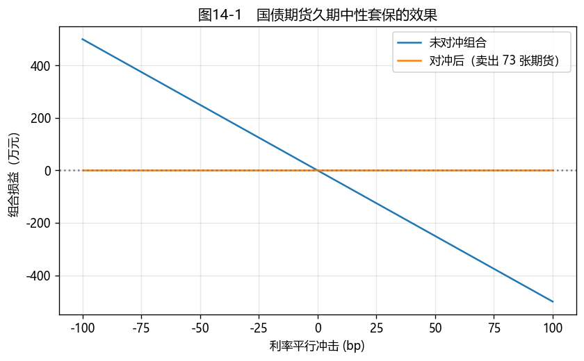

# 第11章　利率期货与远期

[](https://mybinder.org/v2/gh/albertandking/fixed-income/main?labpath=notebooks/ch11_futures_forwards.ipynb)

!!! info "配套代码"
    本章转换因子、CTD、套保比率与 FRA 由 `fi.futures` 实现；案例用国债期货对冲组合久期，离线即可运行。

## 11.1 本章导读与学习目标

前面我们用**现券组合**管理利率风险（第7章免疫、第6章久期）。但调整现券组合需要买卖大量债券、占用大量资金，并对市场形成冲击。**利率衍生品**提供了更高效的工具：借助少量保证金、高流动性的**国债期货**，即可较快地调整整个组合的久期、对冲利率风险。这标志着利率风险管理从"重资产"方式向"轻资本"方式的重要转变。

但国债期货有一项独特的复杂性：它对应的不是某一只具体的债券，而是一个**名义标准券**，其背后对应**一篮子可交割券**。卖方可以选择交割其中哪一只，理性的选择是交割**最便宜可交割券（CTD）**。这一"转换因子 + CTD"机制是国债期货定价与套保的核心，也是本章的重点。本章大量用到第5章的曲线与第6章的久期。

!!! abstract "学习目标"
    学完本章，读者应能：

    1. 解释国债期货的**合约要素、名义标准券、保证金与交割机制**；
    2. 计算**转换因子**，由一篮子可交割券确定**最便宜可交割券（CTD）**；
    3. 用**基差**与 **DV01/久期中性**方法计算套保比率，对冲组合利率风险；
    4. 理解**远期利率协议（FRA）**的机制与估值；
    5. 用 `fi.futures` 计算 CF/CTD/套保手数，回测对冲效果。

!!! note "本章知识结构"
    **国债期货合约**（11.2，名义标准券 + 一篮子可交割券、保证金、交割）
    　↓ 多只券怎么折算、交割哪只
    **转换因子 + 最便宜可交割券 CTD**（11.3，毛基差最小）
    　↓ 期货敏感度由 CTD 决定
    **基差与 DV01 中性套保**（11.4，期货 DV01 ≈ CTD DV01/CF）
    　↓ 锁定未来利率
    **远期利率协议 FRA**（11.5）→ 用国债期货对冲组合久期（11.8）

---

## 11.2 国债期货合约与机制

**国债期货**是约定未来某日按约定价格交割一篮子国债的标准化合约。中国金融期货交易所（**中金所/CFFEX**）上市 **2 年、5 年、10 年、30 年**国债期货，合约标的是**名义标准券**——票面利率 **3%** 的虚拟国债，实际可用一篮子符合期限要求的真实国债交割。

关键机制：

- **名义标准券**：报价基于虚拟的 3% 票息券，避免单一现券被逼仓；
- **一篮子可交割券**：剩余期限落在规定区间的国债均可交割；
- **保证金 + 每日盯市（mark-to-market）**：杠杆交易，每日结算盈亏；
- **实物交割**：到期由期货空头选择交割哪只可交割券，并按**转换因子**换算交割金额。

国债期货的出现之所以显著提升了利率风险管理的效率，可由一个对比说明。设想一家保险公司看空债市、希望将组合久期减半。在没有期货的条件下，它只能直接抛售现券——卖出数十亿元的国债，不仅要承担高昂的买卖价差与冲击成本，还会压低自身其余持仓的价格，且卖出后所得资金仍需重新配置。而借助国债期货，它只需缴纳**相当于合约价值若干百分点的保证金**、卖出相应数量的期货合约，便可较快地将组合久期调整至目标水平，现券持仓则保持不动。换言之，同样是改变利率敞口，前者近似于搬动整座货仓，后者则相当于调整一处参数。这种"以小额保证金、高流动性的标准合约调整大额利率敞口"的能力，使利率风险管理由"重资产"方式转向"轻资本"方式，对冲、久期择时与套利均因此更为灵活、成本更低。由此可见，中金所国债期货上市后迅速成为中国机构管理利率风险的核心工具。

---

## 11.3 转换因子与最便宜可交割券（CTD）

### 11.3.1 转换因子：把实际券折算到名义券

不同可交割券票息、期限各异，价值不一。**转换因子（conversion factor, CF）**用于将可交割券的交割价值标准化。对中金所国债期货，应按对应合约、交割月份及交易所公布的公式计算；在简化教学模型中，可把 CF 理解为以名义票息 3% 对可交割券现金流折现后得到的每元面值价格，但还需遵守付息频率、交割月到下一付息月的月份数、剩余付息次数及四舍五入规则。

- 票息 **>** 名义 3% → CF **> 1**（这券比名义券值钱）；
- 票息 **<** 3% → CF **< 1**。

空头交割时，多头支付的**发票价格（invoice price）= 期货价格 × CF + 应计利息**。

!!! note "中金所转换因子公式"
    中金所的转换因子按合约规则计算，关键参数包括合约票面利率 3%、交割月到下一付息月的月份数、剩余付息次数、可交割国债的票面利率及每年付息次数；计算结果四舍五入至小数点后 4 位。每 100 元可交割国债的应计利息按"实际天数/实际天数"计算，结果四舍五入至小数点后 7 位。本书 `fi.futures.conversion_factor` 用概念定义（以 3% 收益率给该券定价后除以面值）实现，与官方公式在整年、规整情形下一致。教学中的"以 3% 折现"仅用于理解方向和构造简化例题，不能替代交易所针对具体合约与交割月份公布的 CF。可交割券范围、交割结算价格及应计利息同样应以具体合约规则和交易所公布参数为准；本章的简化公式和示例数值用于教学说明，不应替代官方参数或实务计算。

!!! example "例11.1：转换因子"
    名义票息 3% 下，几只可交割券的转换因子：

    | 可交割券 | 转换因子 CF |
    |---|---|
    | 票息 2.8%、7 年 | 0.9875 |
    | 票息 3.2%、8 年 | 1.0140 |
    | 票息 3.0%、9 年 | 1.0000（票息=名义票息→CF=1） |

### 11.3.2 最便宜可交割券（CTD）

空头会选**交割成本最低**的券交割。衡量交割成本的常用指标是**毛基差（gross basis）**：

$$\text{毛基差}=\text{现券净价}-\text{期货价格}\times CF$$

在本章的简化例中，毛基差最小的券被视为 **CTD**。毛基差忽略了持有期融资成本、票息收入、应计利息及交割时点差异；严格的 CTD 判断还应纳入持有期 carry、交割选择权及交割规则，通常比较净基差（最小）或隐含回购利率（最高）。

值得注意的是，CTD 机制的背后同样隐含一份**期权**，只不过其持有者是期货空头。合约允许空头在交割时从一篮子券中选择一只交付，而理性的空头总会选择对自身最有利（交割成本最低）的那只。**从多个选项中择优的权利本身即构成一种选择权**，金融上称为空头的"**交割期权（delivery option）**"或"质量期权（quality option）"。这解释了一个看似异常的现象：国债期货价格往往略低于"直接按 CTD 折算"所对应的价格。究其原因，多头知道自己将被交付那只对空头最有利、对自己最不利的券，于是要求一定的价格折让作为补偿，这一折让正对应交割期权的价值。本书的 CTD 分析采用静态的毛基差近似，把握了问题的主线，但应注意其中的期权属性：它与第9章可赎回债、第10章可转债同属一个母题——只要合约中有一方持有"选择权"，定价中便相应包含一份期权的价值。这也是 CTD 会随利率与曲线形状发生切换的原因：选择权的最优行权对象，本就会随市场环境而变化。

!!! example "例11.2：确定 CTD"
    期货价格 100。三只可交割券的毛基差：

    | 可交割券 | CF | 现券净价 | 期货价×CF | 毛基差 |
    |---|---|---|---|---|
    | 券A(2.8%,7y) | 0.9875 | 99.10 | 98.754 | 0.346 |
    | **券B(3.2%,8y)** | 1.0140 | 101.55 | 101.404 | **0.146** |
    | 券C(3.0%,9y) | 1.0000 | 100.30 | 100.000 | 0.300 |

    **在本简化示例中，券B 毛基差最小（0.146），暂定为 CTD。** 期货价格主要跟随 CTD 的现券价格，期货的利率敏感度也由 CTD 决定——这是套保计算的关键（下一节）。

!!! tip "CTD 会切换"
    CTD 不是固定的：利率水平、曲线形状、票息结构变化都会让 CTD 从一只券切换到另一只。在曲线较为平坦的简化情形下，有一条常用的经验规律：**收益率高于名义票息（3%）时，久期较长的券倾向成为 CTD；收益率低于 3% 时则相反**。但这只是近似规律，票息、剩余期限和曲线形状的相对影响会随市场环境变化，实务中仍需以净基差或隐含回购利率判断。CTD 切换会让期货的久期跳变，是套保中的隐藏风险。

---

## 11.4 基差与套期保值

### 11.4.1 期货的 DV01 由 CTD 决定

既然期货价格跟随 CTD，期货的利率敏感度（DV01）也由 CTD 决定：

$$\text{期货 DV01}\approx\frac{\text{CTD 的 DV01}}{\text{CTD 的转换因子}}$$

### 11.4.2 久期中性（DV01 中性）套保

要用国债期货对冲一个现券组合的利率风险，令**组合 DV01 = 期货头寸 DV01**（方向相反）。所需期货合约数：

$$\boxed{\;N=-\frac{\text{组合 DV01}}{\text{每张期货合约 DV01}}\;}$$

负号表示：持有多头债券组合（怕利率上行）应**卖出**期货。

!!! example "例11.3：用国债期货对冲组合久期"
    一个市值 1 亿元、修正久期 5 的现券组合，DV01 $=5\times10^8\times10^{-4}=50{,}000$ 元/bp。CTD（券B，3.2%/8年）每百元面值 DV01 ≈ 0.0696，CF = 1.0140，故期货每百元 DV01 ≈ 0.0686；每张合约（面值 100 万元）DV01 ≈ 686 元/bp。则：

    $$N=-\frac{50{,}000}{686}\approx -72.8\ \Rightarrow\ \textbf{卖出约 73 张}$$

    卖出 73 张国债期货后，组合对小幅平行利率变动的损益被对冲到接近零（图11-1）。

<figure markdown>
  { width="640" }
  <figcaption>图11-1　利率冲击下，未对冲组合损益随利率大幅波动；卖出久期中性数量的国债期货后，组合损益被对冲到接近水平线</figcaption>
</figure>

!!! warning "套保不是完美的"
    DV01 中性只对冲**一阶、平行**利率风险。残余风险包括：**基差风险**（期货与现券价格不完全同步）、**CTD 切换**（期货久期跳变）、**曲线非平行移动**（组合与 CTD 久期分布不同）、**凸性差异**。套保比率需随利率与 CTD 变化**动态调整**。

---

## 11.5 远期利率协议（FRA）

**远期利率协议（Forward Rate Agreement, FRA）**是锁定未来某段时期借贷利率的场外合约。多头（**付固定、收浮动**）在到期时，按名义本金结算"市场参考利率与约定利率之差"。其价值近似为：

$$V_{\text{多头}}\approx M\times(F-K)\times\tau\times DF$$

其中，$M$ 为名义本金（为与 11.4.2 的套保手数 $N$ 区分，此处记作 $M$），$F$ 为该计息期的远期利率（估值时代替尚未确定的参考利率），$K$ 为合约利率，$\tau$ 为计息年限，$DF$ 为从结算日折现至估值日的折现因子。实际 FRA 通常在计息期开始时以折现后的差额一次性结算，折现分母还可能依据合约约定的参考利率和日计数规则确定。

FRA 的公允约定利率就是第4章的**远期利率**——这把第4–5章的远期曲线与衍生品定价直接连了起来。

!!! example "例11.4：FRA 估值"
    名义本金 1 亿元，合约利率 2.5%，当前市场远期利率 2.8%，期限 $\tau=0.25$ 年（3 个月）。若暂时忽略结算日折现，价值约为 $10^8\times(2.8\%-2.5\%)\times0.25=\mathbf{75{,}000}$ 元。若按计息期开始时结算，还需用适用参考利率将该金额折现；因此 75,000 元是未折现的教学近似值。价值为正，是因为市场远期利率高于约定利率，付固定、收浮动的多头处于有利一方。

---

## 11.6 Python 实现：`fi.futures`

```python
from fi import futures as fut

# 转换因子（例11.1）
fut.conversion_factor(coupon_rate=0.032, years_to_maturity=8)      # 1.0140

# 确定 CTD（例11.2）
bonds = [
    {"name": "A", "clean_price": 99.10, "conversion_factor": fut.conversion_factor(0.028, 7)},
    {"name": "B", "clean_price": 101.55, "conversion_factor": fut.conversion_factor(0.032, 8)},
    {"name": "C", "clean_price": 100.30, "conversion_factor": fut.conversion_factor(0.030, 9)},
]
best, table = fut.ctd(bonds, futures_price=100.0)     # best -> 券B

# 久期中性套保手数（例11.3）
ctd_dv01 = fut.bond_dv01(0.032, 8, 0.032)             # CTD 每百元 DV01
fut.hedge_ratio(portfolio_dv01=50000, ctd_dv01=ctd_dv01, ctd_cf=best["conversion_factor"])

# FRA 估值（例11.4）
fut.fra_value(notional=1e8, contract_rate=0.025, forward_rate=0.028, tau=0.25)   # 75000
```

`conversion_factor` 用概念定义实现；`ctd` 返回毛基差最小的券；`hedge_ratio` 用期货 DV01（= CTD DV01 / CF）算久期中性手数。

---

## 11.7 QuantLib 实现：远期利率

国债期货的 CTD/基差分析通常用上面的显式方法；QuantLib 这边可直接由曲线取**远期利率**（FRA 的公允利率），与第5章的曲线衔接：

```python
import QuantLib as ql

today = ql.Date(15, 6, 2026); ql.Settings.instance().evaluationDate = today
dc = ql.Actual365Fixed()
curve = ql.YieldTermStructureHandle(ql.FlatForward(today, 0.025, dc))
# 1 年后起、3 个月期的远期利率
d1, d2 = today + ql.Period(1, ql.Years), today + ql.Period(15, ql.Months)
fwd = curve.forwardRate(d1, d2, dc, ql.Simple).rate()   # 远期利率 ≈ FRA 公允利率
```

!!! tip "期货 vs 远期：凸性调整"
    理论上期货与远期价格略有差异：期货采用**逐日盯市**，盯市盈亏的再投资收益与利率水平相关，因此在常见的利率模型下，利率期货的隐含利率通常略高于同期限的远期利率，二者之差即"**凸性调整（convexity adjustment）**"。调整幅度取决于利率波动率与期限：短期、低波动情形下可以忽略，长期限利率期货则需作修正。这正是期货与远期看似相同、实则有别之处。

---

## 11.8 案例：用国债期货对冲组合久期

配套 notebook 演示完整的套保流程：

1. **确定 CTD**（例11.2）：从一篮子可交割券中找出 CTD，得到期货的 DV01；
2. **计算套保手数**（例11.3）：用 DV01 中性算出需卖出的期货张数；
3. **回测对冲效果**（图11-1）：模拟利率 ±100bp 冲击，对比未对冲与对冲后组合的损益曲线；
4. **残余风险**：观察曲线非平行移动、CTD 切换下对冲的不完美。

**结论要点**：国债期货可用较小的资金占用调整组合久期，既可用于对冲（将久期降至零），也可用于主动加减久期（久期择时，第17章）。但 DV01 中性仅覆盖一阶平行风险，基差、CTD 切换与曲线风险均为残余敞口，套保需动态再平衡。中金所国债期货为机构提供了管理利率风险的标准化工具；具体工具选择仍取决于流动性、基差、保证金、交割和监管等约束。

---

## 11.9 习题与编程实验

**概念题**

1. 国债期货为什么用"名义标准券 + 一篮子可交割券"，而不是单一现券？这避免了什么问题？
2. 转换因子的作用是什么？为什么票息高于名义票息的券 CF > 1？
3. 什么是 CTD？为什么期货的久期由 CTD 决定？CTD 会在什么情况下切换？
4. DV01 中性套保对冲了哪类风险？留下哪些残余风险？

**计算题**

5. 名义票息 3%，求票息 2.5%、5 年期券与票息 4%、10 年期券的转换因子（用概念定义）。
6. 组合 DV01 = 8 万元/bp，CTD 每张合约 DV01 = 700 元/bp，求久期中性套保所需期货张数与方向。

**编程实验**

7. 用 `fi.futures` 复现例11.1、例11.2，再改变期货价格，观察 CTD 是否切换。
8. 复现例11.3 与图11-1：用久期中性法对冲一个组合，模拟 ±100bp 冲击，画出未对冲 vs 对冲后的损益曲线。
9. 用 `fi.futures.fra_value` 复现例11.4；再用 QuantLib 由一条曲线取远期利率，作为 FRA 的公允约定利率。

---

## 11.10 习题参考答案与详解

!!! tip "完整可运行解答 notebook"
    本节编程实验的**完整可运行代码**见 [`notebooks/solutions/ch11_solutions.ipynb`](https://github.com/albertandking/fixed-income/blob/main/notebooks/solutions/ch11_solutions.ipynb)（可在本地或通过 Binder 在线运行）。

!!! success "概念题 1"
    用"名义标准券 + 一篮子可交割券"，是为了**避免单一现券被逼仓（squeeze）**：若只许交割某一只券，空头到期必须买入该券，多头可囤券抬价。一篮子可交割让空头能选最便宜的券交割，市场更难操纵；名义标准券（3% 票息虚拟券）则提供统一报价基准。

!!! success "概念题 2"
    **转换因子**把各异的可交割券折算到名义标准券，使交割金额可比（发票价 = 期货价 × CF + 应计）。**票息 > 名义票息（3%）的券 CF > 1**：在简化教学口径下，CF 可理解为以名义票息 3% 对该券现金流折现得到的每元面值价格（中金所实际 CF 还需按交割月、付息频率等规则计算并以交易所公布值为准），高票息券在 3% 折现下溢价（价值 > 面值），故 CF > 1。

!!! success "概念题 3"
    **CTD（最便宜可交割券）**是综合考虑交割收入、持有期融资成本、票息收入、应计利息及交割规则后，空头交割经济成本最低的券。静态毛基差最小只能作为简化判断，不能在所有市场环境下直接等同于 CTD。**期货久期由 CTD 决定**：期货价格主要跟随 CTD 的现券价格，故其利率敏感度也主要由 CTD 决定（期货 DV01 ≈ CTD DV01 / CF），但还会受到基差和交割选择权的影响。**CTD 切换**：当收益率水平相对名义票息 3% 发生变化，或曲线形状（陡峭化、平坦化）改变时，各券的净基差（或隐含回购利率）排序可能改变，CTD 随之从一只券切换到另一只。在曲线较平坦的简化情形下，经验上收益率高于 3% 时久期较长的券倾向成为 CTD，低于 3% 时久期较短的券倾向成为 CTD；实务中应以净基差或隐含回购利率的实际计算为准。

!!! success "概念题 4"
    DV01 中性套保对冲**一阶、平行**利率风险。残余风险：① **基差风险**（期货与现券不完全同步）；② **CTD 切换**（期货久期跳变）；③ **曲线非平行移动**（组合与 CTD 久期分布不同）；④ **凸性差异**。故套保比率需随利率与 CTD 动态调整。

!!! success "计算题 5"
    用概念定义（以名义票息 3% 给券定价 / 面值）：

    - 票息 2.5%、5 年：以 3% 折现 → 折价 → $CF=\mathbf{0.9771}$（< 1，因票息 < 3%）；
    - 票息 4%、10 年：以 3% 折现 → 溢价 → $CF=\mathbf{1.0853}$（> 1）。

    （用 `fi.futures.conversion_factor(0.025, 5)`、`conversion_factor(0.04, 10)` 验证。）

!!! success "计算题 6"
    久期中性套保手数 $N=-\dfrac{\text{组合 DV01}}{\text{每张期货 DV01}}=-\dfrac{80000}{700}=\mathbf{-114.3}$，即**卖出约 114 张**期货（多头组合怕利率上行，用空头期货对冲）。

!!! success "编程实验 7–9（要点）"
    - **实验 7**：`fi.futures` 复现 CF（例11.1）与 CTD（例11.2，CTD=券B）；改变期货价格会改变各券毛基差，可能触发 **CTD 切换**。
    - **实验 8**：用 DV01 中性算套保手数（例11.3，N≈−73），±100bp 冲击下未对冲组合损益 ±500 万、对冲后接近水平线（图11-1）。
    - **实验 9**：`fra_value` 复现例11.4（75000 元）；QuantLib 由曲线 `forwardRate` 取远期利率作为 FRA 公允约定利率（注意期货与远期间的凸性调整）。

---

## 11.11 本章小结

- **国债期货**以**名义标准券（3% 票息）+ 一篮子可交割券**交易，保证金 + 每日盯市 + 实物交割。
- **转换因子**把实际券折算到名义券；空头选择经济交割成本较低的 CTD。毛基差最小仅是简化筛选，期货价格与久期通常主要受 CTD 影响。
- **DV01 中性套保**：$N=-\text{组合 DV01}/\text{每张期货 DV01}$，期货 DV01 ≈ CTD DV01 / CF；只对冲一阶平行风险，留有基差、CTD 切换、曲线残余风险。
- **FRA** 锁定未来利率，公允约定利率 = 远期利率；价值 = 名义 ×（远期−合约）× τ × DF。
- `fi.futures` 实现 CF/CTD/套保/FRA；期货与远期间有**凸性调整**的精微差异。

下一章（第12章）进入**利率互换**：把"未来一系列利率"打包交换，是场外利率衍生品中体量最大、应用最广的品种，定价同样建立在第5章的曲线之上。

!!! note "关键公式速查"
    | 概念 | 公式 |
    |---|---|
    | 转换因子 | 简化口径：以名义票息(3%)对该券现金流折现的每元面值价格；实务以中金所公布值为准 |
    | 发票价格 | 期货价格 × CF + 应计利息 |
    | 毛基差 | 现券净价 − 期货价 × CF；仅作简化筛选，实务需考虑 carry/净基差 |
    | 期货 DV01 | ≈ CTD 的 DV01 / CTD 的 CF |
    | 套保手数 | $N=-\text{组合 DV01}/\text{每张期货 DV01}$ |
    | FRA 价值 | 名义 ×（远期−合约）× τ × DF |

!!! quote "延伸阅读"
    - Hull, *Options, Futures, and Other Derivatives*，"Interest Rate Futures" 章（转换因子、CTD、久期套保的标准论述）；
    - Fabozzi, *Bond Markets, Analysis, and Strategies*，"Treasury Futures" 与套保章节；
    - 中国金融期货交易所国债期货合约规则、交割细则与转换因子计算说明（见[10 年期国债期货产品页](http://www.cffex.com.cn/cn/10t.html)"转换因子和应计利息计算"栏目；[2 年期](http://www.cffex.com.cn/cn/2ts.html)、[5 年期](http://www.cffex.com.cn/5tf/)、[30 年期](http://www.cffex.com.cn/cn/30tl.html)品种页面同）。
