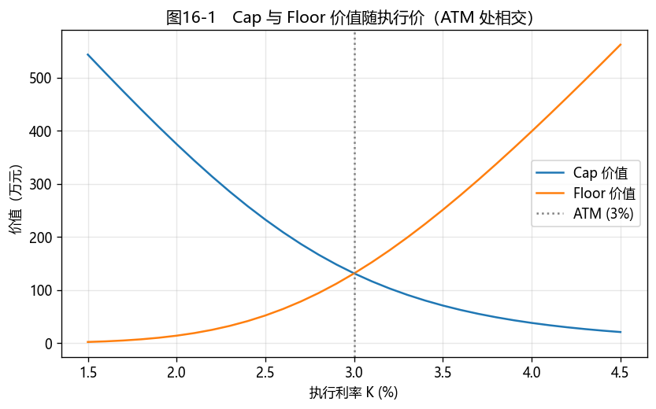

# 第13章　利率期权

[](https://mybinder.org/v2/gh/albertandking/fixed-income/main?labpath=notebooks/ch13_ir_options.ipynb)

!!! info "配套代码"
    本章 Cap/Floor/Swaption 的 Black 定价、隐含波动率由 `fi.rateopt` 实现，并可与 QuantLib `CapFloor` 对拍。对拍时必须统一曲线、日期、日计数、支付频率、已知 fixing 与结算约定。

## 13.1 本章导读与学习目标

第11章的期货、第12章的互换都是**线性**工具——损益与利率近似成正比。本章进入**非线性**的世界：**利率期权**。它给持有者"权利而非义务"，从而提供**不对称**的保护——只在利率朝不利方向变动时赔付，朝有利方向变动则保留收益。

有浮动利率贷款的企业怕利率上行，可以买一个**利率上限（Cap）**：利率超过上限就获赔，没超过则不行权，最多损失权利金。这正是期权"下有保底、上不封顶"的魅力。本章用 **Black 模型**给 Cap/Floor 与**互换期权（Swaption）**定价，并引入利率衍生品交易的核心——**波动率曲面**。这是第四部分（利率衍生品和高级品种）的收尾，也把"期权"这条线（第9–10章的嵌入期权）推向显式的利率期权。

!!! abstract "学习目标"
    学完本章，读者应能：

    1. 描述**利率上限、下限、双限（Cap/Floor/Collar）**与**互换期权（Swaption）**的结构与用途；
    2. 用 **Black 模型**为 caplet/floorlet/swaption 定价，理解**caplet 到期日 = 利率重置日**；
    3. 验证 **Cap−Floor 平价**（= 同执行价的 payer 互换）；
    4. 由价格反求**隐含波动率**，理解**波动率曲面/微笑**；
    5. 用 `fi.rateopt` 与 QuantLib 定价并对拍；
    6. 区分 Black、Normal（Bachelier）及 shifted-lognormal 波动率报价。

!!! note "本章知识结构"
    **Cap / Floor / Collar**（13.2，caplet=看涨、floorlet=看跌）→ **Cap−Floor = payer 互换**（连第12章）
    　↓ 进入互换的期权
    **Swaption**（13.3，可赎回债在简化条件下可近似为内嵌 receiver swaption，连第9章）
    　↓ 怎么定价
    **Black 模型**（13.4，到期=重置日是关键细节）
    　↓ 报价的语言
    **隐含波动率与波动率曲面**（13.5）→ 波动率曲面构建（13.8）

---

## 13.2 利率上限、下限与双限

### 13.2.1 Cap：一串看涨期权

**利率上限（Cap）**：买方在每个重置期，若浮动利率高于约定**执行利率（strike）$K$**，就收到 $(\text{利率}-K)$ 的赔付。它由一串**caplet**组成——每个 caplet 是对该期浮动利率的**看涨期权**：

$$\text{caplet 赔付}=M\times\tau\times\max(L-K,\ 0)$$

其中 $M$ 为名义本金，$\tau$ 为该计息期间按合约日计数惯例计算的年化因子，$L$ 为重置日确定的参考利率。Cap 是浮动利率借款人的"利率保险"：限制参考利率部分的融资成本上行，又保留利率下行时少付利息的好处。

可以把 Cap 理解为一张**保险单**，其各要素与保险概念一一对应。执行利率 $K$ 相当于保险的**免赔额（起赔点）**：利率涨过 $K$ 才开始赔付，未涨过则不赔。买 Cap 支付的**权利金**相当于**保费**，是一笔确定的、不论将来是否出险都不退还的支出。而构成 Cap 的一串 caplet，相当于把一份"三年期利率保险"按每个重置期**拆分为若干张独立的保单**，每张分别判断该期利率是否超过 $K$、是否赔付。这一结构的关键特征在于其**不对称性**：企业买入 Cap 之后，若利率大幅上行，超出部分由 Cap 赔付，参考利率部分的融资成本被限制在 $K$ 附近；若利率不升反降，企业仍可享受较低利率，所付出的仅为权利金。**不利方向获得补偿、有利方向收益保留**，正是期权区别于期货、互换等线性工具之处。实际融资成本还可能包含信贷利差、基准失配或权利金摊销，因而不应把 Cap 理解为对全部融资成本的无条件封顶。

### 13.2.2 Floor 与 Collar

- **利率下限（Floor）**：由 **floorlet**（看跌期权）组成，浮动利率低于 $K$ 时赔付——浮动利率投资者（怕利率下行）的保护；
- **双限（Collar）**：对浮动利率借款人，常见结构是**买 Cap + 卖 Floor**，用卖 Floor 的权利金抵消买 Cap 的成本，把参考利率的净效果限制在一个区间内；代价是利率跌破 Floor 执行价后，不再享受全部降息收益；
- **零成本 Collar**：选择 Floor 执行价，使卖 Floor 的权利金恰好抵消买 Cap 的成本。这里"零成本"仅指**初始净权利金为零**，不表示未来没有现金流或风险。

### 13.2.3 Cap−Floor 平价

在名义本金、日期、日计数、参考利率和执行价均相同的前提下，**买 Cap + 卖 Floor = 一笔付固定 $K$ 的 payer 互换**：

$$\boxed{\;\text{Cap}(K)-\text{Floor}(K)=\text{payer 互换}(K)\;}$$

直觉：caplet−floorlet 的赔付 $=M\tau[\max(L-K,0)-\max(K-L,0)]=M\tau(L-K)$，正是互换每期的净现金流。当 $K$ 等于**同一支付安排下标的互换的平价固定利率**（ATM）时，payer 互换价值为零，故 **ATM 时 Cap = Floor**。这是第12章互换与本章期权之间的桥梁。

---

## 13.3 互换期权（Swaption）

**互换期权（Swaption）**是"进入一笔利率互换的权利"：

- **payer swaption**：未来按约定固定利率**付固定**进入互换的权利（看涨利率）；
- **receiver swaption**：**收固定**进入互换的权利（看跌利率）。

用途广泛：企业锁定未来融资的利率上限、对冲或表达对未来利率波动的看法。实物交割的 swaption 行权后生成标的互换；现金结算 swaption 则按约定公式支付现金，两种方式的年金和折现约定可能不同。

在无信用风险、现金流与行权日期能够匹配、且可用固定付息债与利率互换复制的简化框架下，第9章可赎回债的赎回权常可近似理解为一个内嵌的 **receiver swaption**。因此可写作"可赎回债 ≈ 普通债 − receiver swaption"。这是一项经济直觉而非一般情形下的严格恒等式：赎回价格、通知期、信用利差、税费与多次行权权利均会造成差异。

---

## 13.4 Black 模型定价

### 13.4.1 Black（1976）公式

利率期权的标准定价常用 **Black 模型**——把"远期利率/远期互换利率"当作对数正态分布的标的。对正的 $F$ 和 $K$，caplet（对期间 $[T_{i-1},T_i]$ 的远期利率 $F$ 的看涨）为：

$$\text{caplet}=M\times\tau\times DF(T_i)\times\big[F\,\Phi(d_1)-K\,\Phi(d_2)\big]$$
$$d_1=\frac{\ln(F/K)+\tfrac12\sigma^2 T}{\sigma\sqrt T},\quad d_2=d_1-\sigma\sqrt T$$

对应 floorlet 为：

$$\text{floorlet}=M\times\tau\times DF(T_i)\times\big[K\,\Phi(-d_2)-F\,\Phi(-d_1)\big]$$

其中 $\Phi(\cdot)$ 表示标准正态分布函数，$\tau$ 仍为该计息期间的年化因子（同 13.2.1）。Swaption 类似，把 $F$ 换成**远期互换利率**、把 $\tau\,DF(T_i)$ 换成标的互换的**年金因子** $A=\sum_{j}\tau_j\,DF(T_j)$（对标的互换固定腿各支付日求和）。实物交割 payer swaption 的价值为 $M\times A\times[F\,\Phi(d_1)-K\,\Phi(d_2)]$，此时 $T$ 取期权到期日；receiver swaption 将括号换为 $K\,\Phi(-d_2)-F\,\Phi(-d_1)$。

!!! warning "关键细节：caplet 到期日 = 利率重置日，不是支付日"
    对期间 $[T_{i-1},T_i]$ 的 caplet，其浮动利率在**期初 $T_{i-1}$ 重置（观测）**、在**期末 $T_i$ 支付**。所以 Black 公式里的**到期时间 $T$ 用重置日 $T_{i-1}$**（波动累积到利率被观测为止），而**折现因子用支付日 $DF(T_i)$**。初学者常误用支付日作为到期日，会高估期权时间价值。

    第一个 caplet 的利率如已在期初定盘，则不再有时间价值；若现金流尚未支付，仍应把已知内在价值作为确定现金流计入 Cap 价值，而不能一概忽略。

!!! note "单曲线与多曲线"
    本章为说明机制，直接给定远期利率和折现因子。实务中，远期利率与折现因子可能来自不同曲线（例如相应远期曲线和抵押协议对应的 OIS 折现曲线）；曲线和抵押约定不同会带来价格差异。

### 13.4.2 定价示例

!!! example "例13.1：单个 caplet"
    一个 caplet：远期利率 3%、执行 3%、重置在 1 年后、支付在 2 年后、波动率 20%、名义 1 亿、$DF(2)=1.03^{-2}$。Black 价值 ≈ **225{,}249 元**。

!!! example "例13.2：ATM Cap 与 Floor"
    一个覆盖第 1–4 个重置期的 Cap（4 个 caplet，重置在 $t=1,2,3,4$，远期均 3%，vol 20%，名义 1 亿）。执行价 = 3%（ATM）：

    | 执行价 $K$ | Cap | Floor | Cap−Floor | payer 互换 |
    |---|---|---|---|---|
    | 2% | 3,746,102 | 137,268 | **3,608,833** | 3,608,833 |
    | 3%(ATM) | **1,310,756** | **1,310,756** | **0** | 0 |
    | 4% | 377,518 | 3,986,352 | **−3,608,833** | −3,608,833 |

    **Cap−Floor 在每个执行价都精确等于 payer 互换价值**（平价验证）；本例中所有远期均为 3%，故匹配互换的 ATM 固定利率也是 3%。

!!! example "例13.3：Swaption"
    一个 1 年后进入 4 年期 payer 互换的 swaption，远期互换利率 3%、执行 3%、vol 20%、名义 1 亿。Black 价值 ≈ **862{,}392 元**。

---

## 13.5 隐含波动率与波动率曲面

### 13.5.1 隐含波动率

Black 公式里唯一不可直接观测的输入是**波动率 $\sigma$**。反过来，给定市场期权**价格**，可反解出令 Black 价格等于市价的 $\sigma$——即**隐含波动率（implied volatility）**。它是市场对未来利率波动的定价，是利率期权交易的"通用语言"（报价常直接报波动率而非价格）。实际求解前还应检查市价是否落在无套利界限内；极短期限、深度实值或接近价格界限的期权，其隐含波动率对报价误差可能很敏感。

!!! example "例13.4：隐含波动率"
    用 20% 波动率算出例13.1 caplet 的价格，再由该价格反求隐含波动率，精确得回 **20.00%**——`fi.rateopt.implied_vol` 用 Brent 法求解。

### 13.5.2 波动率微笑与曲面

如果 Black 模型完美，所有执行价、所有期限的隐含波动率应当相同。但市场不是——隐含波动率随**执行价**变化（**波动率微笑/偏斜 smile/skew**）、随**期限**变化（**期限结构**）。把两者放在一起，就是**波动率曲面（vol surface）**：

- **Cap/Floor 波动率曲面**：市场通常按 Cap 到期日（或最末支付日）× 执行价报价；整份 Cap 的报价不必等于每个 caplet 共用的波动率，逐期 caplet 波动率通常需要剥离或校准；
- **Swaption 波动率立方体（vol cube）**：维度 = 期权期限 × 互换期限 × 执行价（或 moneyness）。

交易台用整张曲面给一切利率期权一致定价、做风险管理。

波动率微笑反映出 **Black 模型假设的局限**。若市场以同一常数 Black 波动率给所有执行价定价，隐含波动率会是一条水平线；实际曲线则常出现偏斜、两端上翘或其他形态，并不一定对称。它说明单一常数波动率不能同时解释所有报价。两端上翘的含义在于：现实中利率大幅上行或下行的频率往往高于对数正态分布的预测（即分布呈**厚尾**），而这类极端情形正是期权买方最关注的保护对象，市场因此对远离平值的期权给出额外定价。远离平值期权的波动率形状可能反映市场对尾部风险的定价，也可能受到供求、流动性和对冲成本影响。因此，隐含波动率是市场价格的表达方式，不应直接视为对未来客观概率的唯一判断。交易员维护整张随执行价与期限变化的曲面，是为了使定价与风险管理尽量贴近市场报价。

!!! note "低利率/负利率：从对数正态到正态波动率"
    Black 模型假设利率**对数正态**（不能为负）。在低利率或负利率环境下，市场可使用 **正态（Bachelier）波动率** 或**移位对数正态（shifted lognormal）**。报价时务必分清是 **Black（对数正态）波动率**、**Normal（正态）波动率**，还是带明确位移量的 shifted-Black 波动率——三者数值与含义不能直接比较。

---

## 13.6 Python 实现：`fi.rateopt`

```python
from fi import rateopt as ro

# 单个 caplet（重置 1y、支付 2y、F=K=3%、vol=20%）——例13.1
ro.black_caplet(forward=0.03, strike=0.03, vol=0.20, t=1, tau=1, df=1.03**-2)   # ≈225,249

# Cap / Floor（4 个 caplet，重置 t=1..4）——例13.2
resets, pay_dfs = [1, 2, 3, 4], [1.03**-t for t in (2, 3, 4, 5)]
ro.black_cap([0.03]*4, 0.03, 0.20, resets, [1]*4, pay_dfs, kind="cap")    # ≈1,310,756
ro.black_cap([0.03]*4, 0.03, 0.20, resets, [1]*4, pay_dfs, kind="floor")  # = Cap（ATM）

# Swaption（1y -> 4y payer）——例13.3
ro.black_swaption(0.03, 0.03, 0.20, expiry=1, swap_annuity=sum(pay_dfs))   # ≈862,392

# 隐含波动率 ——例13.4
ro.implied_vol(225249, 0.03, 0.03, 1, 1, 1.03**-2)   # ≈0.20
```

注意 `black_caplet` 的参数把**到期时间 `t`（重置日）**与**折现 `df`（支付日）**分开——这正是 13.4 强调的关键细节。以上各函数未显式传入 `notional` 时，名义本金按默认值 1 亿元计算。

---

## 13.7 QuantLib 实现：`CapFloor`

```python
import math
import QuantLib as ql

today = ql.Date(15, 6, 2026); ql.Settings.instance().evaluationDate = today
dc, cal = ql.Actual365Fixed(), ql.NullCalendar()
# 连续复利 log(1.03) 对应年度简单远期 3%，以便与本章示例对齐
ts = ql.YieldTermStructureHandle(ql.FlatForward(today, math.log(1.03), dc, ql.Continuous))
idx = ql.IborIndex("Idx", ql.Period(1, ql.Years), 0, ql.CNYCurrency(), cal,
                   ql.Unadjusted, False, dc, ts)
sched = ql.Schedule(today, today + ql.Period(5, ql.Years), ql.Period(1, ql.Years), cal,
                    ql.Unadjusted, ql.Unadjusted, ql.DateGeneration.Forward, False)
cap = ql.Cap(ql.IborLeg([1e8], sched, idx), [0.03])
cap.setPricingEngine(ql.BlackCapFloorEngine(ts, ql.QuoteHandle(ql.SimpleQuote(0.20)), dc))
cap.NPV()   # ≈1,311,843（例13.2 为 1,310,756，差异来自闰年计息天数）
```

!!! tip "对拍差异"
    `fi.rateopt` 用整年、规整折现展示机制；QuantLib 走真实日期、日计数、曲线与 fixing 规则。上例统一复利方式后，QuantLib 得 Cap NPV ≈ 1,311,843 元，与例13.2 的 1,310,756 元相差约 1,087 元（约 0.08%）：首期 caplet 在估值日即已定盘（$F=K$，内在价值为零），其余 4 期与 fi 一一对应，剩余差异来自日计数：第 2 期（2027-06-15 → 2028-06-15）跨 2028 闰年，Actual365Fixed 下 $\tau=366/365$ 略大于 1，其后各期的到期时间与折现时间也相应多出 1 天；若把日计数改为 30/360，两者完全一致。一般地，对拍前应逐项统一估值日、已知 fixing、支付/重置日、日计数、支付频率、业务日调整、名义本金、曲线复利方式、远期与折现曲线、波动率类型和结算方式。只凭"同量级"不能判断两个实现是否一致。

---

## 13.8 案例：波动率曲面构建与解读

配套 notebook 演示：

1. **Cap/Floor vs 执行价**（图13-1）：画出 Cap 与 Floor 价值随执行价的曲线，定位 ATM 交点，验证 Cap−Floor 平价；
2. **隐含波动率反求**：由一组（合成）市场价格反求隐含波动率，画出**波动率微笑**；
3. **波动率曲面**：构建期限 × 执行价的隐含波动率网格，观察期限结构与偏斜；
4. **Collar 构造**：用买 Cap + 卖 Floor 构造零成本 Collar，求使成本为零的 Floor 执行价。

**结论要点**：利率期权提供非线性、不对称的利率保护；定价可使用 Black 或适用的替代模型，交易和风险管理依赖波动率曲面。中国银行间市场已提供利率互换期权以及利率上/下限期权等交易服务；具体产品、参考利率、准入与结算约定应以当期业务规则为准。

<figure markdown>
  { width="640" }
  <figcaption>图13-1　Cap 价值随执行价下降、Floor 随执行价上升，在 ATM（3%）处相交（此处 Cap=Floor）；二者之差 = payer 互换</figcaption>
</figure>

---

## 13.9 习题与编程实验

**概念题**

1. Cap、Floor、Collar 分别保护谁、对冲什么风险？零成本 Collar 如何构造，"零成本"具体指什么？
2. 用 caplet−floorlet 的赔付证明 Cap−Floor 平价（= payer 互换）；为什么在匹配标的互换的 ATM 执行价时 Cap = Floor？
3. payer swaption 与 receiver swaption 各是什么权利？实物交割与现金结算有何区别？为什么可赎回债与 receiver swaption 的关系只是近似？
4. （1）为什么 caplet 的 Black 到期时间用重置日而非支付日？误用支付日会高估还是低估期权价值？（2）第一个已定盘但尚未支付的 caplet 应如何估值？

**计算题**

5. 一个 caplet：远期 2.5%、执行 3%、重置 2 年、支付 3 年、vol 25%、名义 1 亿，求其 Black 价值（用 DF=1.03⁻³）。
6. 由市场报价：某 ATM caplet 价值 30 万元（F=K=3%、重置 1y、支付 2y、名义 1 亿），反求隐含波动率。

**编程实验**

7. 用 `fi.rateopt` 复现例13.1–13.4，并复现图13-1（Cap/Floor vs 执行价），验证 Cap−Floor 平价。
8. 构造一组不同执行价的（合成）caplet 价格，用 `implied_vol` 反求隐含波动率并画**波动率微笑**。
9. 用 `fi.rateopt.black_swaption` 计算不同期权期限 × 执行价的 swaption 价格，反求隐含波动率，构建一张小型**波动率曲面**。

---

## 13.10 习题参考答案与详解

!!! tip "完整可运行解答 notebook"
    本节编程实验的**完整可运行代码**见 [`notebooks/solutions/ch13_solutions.ipynb`](https://github.com/albertandking/fixed-income/blob/main/notebooks/solutions/ch13_solutions.ipynb)（可在本地或通过 Binder 在线运行）。

!!! success "概念题 1"
    **Cap（上限）**保护浮动利率**借款人**（利率超上限获赔，对冲加息）；**Floor（下限）**保护浮动利率**投资者/放款人**（利率低于下限获赔，对冲降息）；**Collar（双限）= 买 Cap + 卖 Floor**，把利率锁在区间内。**零成本 Collar**：选择 Floor 的执行价，使卖 Floor 的权利金恰好抵消买 Cap 的成本（净权利金为零）；它不表示未来没有现金流或风险。

!!! success "概念题 2"
    caplet−floorlet 的赔付 $=M\tau[\max(L-K,0)-\max(K-L,0)]=M\tau(L-K)$，正是 payer 互换每期的净现金流（收浮动 $L$、付固定 $K$）。把各期加总，**Cap(K)−Floor(K) = 付固定 K 的 payer 互换**。只有现金流约定匹配，且 $K=$ 匹配标的互换的平价固定利率时，payer 互换价值为零，故 **Cap = Floor**。

!!! success "概念题 3"
    **payer swaption** = 未来按约定固定利率**付固定**进入互换的权利（看涨利率）；**receiver swaption** = **收固定**进入互换的权利（看跌利率）。实物交割时行权生成互换，现金结算时按约定公式支付现金。**可赎回债与 receiver swaption** 的联系是简化复制框架下的近似：赎回价格、通知期、信用利差、税费和多次行权都会造成差异。

!!! success "概念题 4"
    （1）caplet 的浮动利率在**期初（重置日 $T_{i-1}$）观测、期末支付**，波动只累积到利率被观测为止，故 Black 到期时间用**重置日**；折现因子用支付日 $DF(T_i)$。**误用支付日会高估**期权价值：到期时间被拉长，多算了波动累积时间，时间价值偏大。

    （2）首期利率在期初已经定盘，不再有不确定性，也就没有时间价值；若该期现金流尚未支付，应按已知利率计算赔付 $M\tau\max(L-K,0)$，再以支付日折现因子折现，作为确定现金流计入 Cap 价值。

!!! success "计算题 5"
    caplet：远期 2.5%、执行 3%、重置 2 年、vol 25%、名义 1 亿、$DF=1.03^{-3}$。因 $F<K$（价外），主要是时间价值。用 `fi.rateopt.black_caplet(0.025, 0.03, 0.25, t=2, tau=1, df=1.03**-3, notional=1e8)` 得 **≈ 169{,}647 元**。

!!! success "计算题 6"
    ATM caplet（F=K=3%、重置 1y、支付 2y、名义 1 亿）市价 30 万元，反求 Black 隐含波动率：用 `fi.rateopt.implied_vol(300000, 0.03, 0.03, t=1, tau=1, df=1.03**-2, notional=1e8)` 得 **≈ 26.67%**。隐含波动率是把市场价格"翻译"成波动率的通用语言。

!!! success "编程实验 7–9（要点）"
    - **实验 7**：`fi.rateopt` 复现例13.1–13.4；图13-1 中 Cap 随执行价下降、Floor 上升，在 ATM 相交，且 Cap−Floor 在每个执行价都等于 payer 互换（平价验证）。
    - **实验 8**：给一组执行价造（带偏斜的）caplet 价格，`implied_vol` 反求得**波动率微笑/偏斜**（隐含波动率随执行价变化，而非常数）。
    - **实验 9**：`black_swaption` 算期权期限 × 执行价网格的价格，反求隐含波动率，拼成小型**波动率曲面**——利率期权交易的核心工具。

---

## 13.11 本章小结

- **利率期权**提供非线性、不对称的利率保护：**Cap**（caplet=看涨）保护借款人、**Floor**（floorlet=看跌）保护投资者、**Collar**=买 Cap+卖 Floor。
- **Cap−Floor 平价**：同一合约要素、同执行价下 = payer 互换；匹配标的互换的 ATM 固定利率下 Cap = Floor——连接第12章互换与本章期权。
- **Swaption** 是进入互换的权利；可赎回债在简化复制框架下可近似理解为内嵌一个 **receiver swaption**。
- **Black 模型**给 caplet/floorlet/swaption 定价；**caplet 到期 = 重置日、折现用支付日**是关键细节；实务中还须统一曲线、日计数和 fixing。
- **隐含波动率**是市场报价语言；**波动率曲面/微笑**是交易核心；低/负利率时须分清**正态（Bachelier）**、Black 与 shifted-lognormal 波动率约定。

至此，第四部分的利率衍生品告一段落。下一部分（第五部分，第14–15章）转向**信用与结构化产品**：在利率风险之外引入违约与信用利差，并讨论资产证券化等结构化产品的现金流分层与定价。

!!! note "关键公式速查"
    | 概念 | 公式 |
    |---|---|
    | caplet（Black） | $M\,\tau\,DF(T_i)\,[F\,\Phi(d_1)-K\,\Phi(d_2)]$ |
    | floorlet（Black） | $M\,\tau\,DF(T_i)\,[K\,\Phi(-d_2)-F\,\Phi(-d_1)]$ |
    | $d_1,d_2$ | $d_1=\dfrac{\ln(F/K)+\tfrac12\sigma^2T}{\sigma\sqrt T}$，$d_2=d_1-\sigma\sqrt T$ |
    | Cap−Floor 平价 | $\text{Cap}(K)-\text{Floor}(K)=\text{payer 互换}(K)$；匹配互换 ATM 时 Cap = Floor |
    | Swaption（payer） | $M\,A\,[F\,\Phi(d_1)-K\,\Phi(d_2)]$，$A=\sum_j\tau_j\,DF(T_j)$ |
    | 关键细节 | 到期时间 = 重置日；折现 = 支付日 |

!!! quote "延伸阅读"
    - Hull, *Options, Futures, and Other Derivatives*，"Interest Rate Derivatives: The Standard Market Models"（Black 模型、Cap/Floor、Swaption）；
    - Brigo & Mercurio, *Interest Rate Models — Theory and Practice*（波动率曲面、SABR、shifted lognormal 的系统论述）；
    - [中国货币网：本币交易系统"产品和交易"说明](https://www.chinamoney.com.cn/chinese/mgbbcphjy/)（见其中"利率期权"栏）；
    - [中国货币网：关于利率期权业务试运行上线的通知](https://www.chinamoney.com.cn/chinese/rdgz/20200313/1565533.html)（中汇交发〔2020〕51 号，附《银行间市场利率期权交易规则（试行）》）；
    - [中国货币网：关于本币交易系统新增利率期权标的基准利率的通知](https://www.chinamoney.com.cn/chinese/rdgz/20210319/1918199.html)（中汇交发〔2021〕86 号，新增挂钩 FDR001、FDR007 的利率互换期权与利率上/下限期权）。
