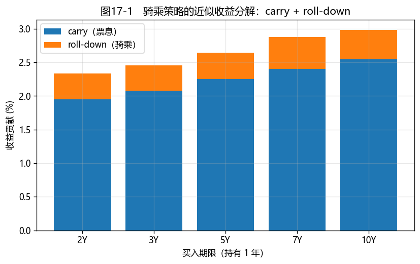
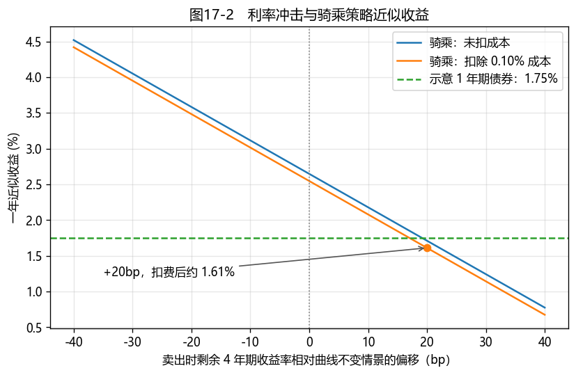

# 第17章　债券投资策略与回测

[](https://colab.research.google.com/github/albertandking/fixed-income/blob/main/notebooks/ch17_strategies.ipynb) [](https://mybinder.org/v2/gh/albertandking/fixed-income/main?labpath=notebooks/ch17_strategies.ipynb)

!!! info "配套代码"
    本章用 `fi.backtest` 演示单期收益分解与绩效评估。配套曲线是按中国国债常见期限设置的**教学示意数据，并非历史行情**；两条收益序列也由程序生成，均可离线复现。

## 17.1 本章导读与学习目标

前面各章介绍了债券定价、收益率曲线、久期和不同债券品种。本章讨论如何运用这些工具制定投资策略，并评价策略的收益来源、风险和成本。

债券投资分为**主动管理**（调整久期、期限或信用暴露，争取相对基准的超额收益）与**被动管理**（尽量跟踪指数或既定持有规则）。两者都需要检验实际收益、风险和成本，并解释收益来源。本章先用简单例子理解 carry、骑乘与利率变动，再用配套代码演示收益分解和绩效指标；示意结果不代表任何策略在真实市场中的预期收益。

!!! abstract "学习目标"
    学完本章，读者应能：

    1. 区分**主动**（久期择时、骑乘曲线、子弹/哑铃、利差策略）与**被动**（买入持有、指数复制）管理；
    2. 解释**骑乘曲线（riding the yield curve）**策略，并分解其假设收益；
    3. 把债券收益**分解**为 carry + roll-down + 久期 + 凸性（+ 利差）；
    4. 用 `fi.backtest` 计算**绩效指标**（年化收益、波动、夏普、最大回撤）；
    5. 用示意国债曲线分解骑乘策略的假设收益、用合成收益序列练习绩效评价，检查利率冲击与成本如何改变结果，并说明完整历史回测还需要哪些数据和交易规则。

---

!!! note "本章知识结构"
    **主动管理**（17.2，久期择时 / 骑乘曲线 / 子弹哑铃 / 利差）
    　↓ 对照
    **被动管理**（17.3，买入持有 / 分层抽样复制指数、跟踪误差）
    　↓ 检验与拆解
    **回测框架 + 收益分解**（17.4，carry + roll-down + 久期 + 凸性；相对基准的主动收益）
    　↓
    `fi.backtest` 实现（17.5）→ 教学数据演示与真实回测所需条件（17.6）

## 17.2 主动管理策略

主动管理通过调整期限、久期或信用暴露，争取取得相对基准的超额收益。常见方法包括：

### 17.2.1 久期择时（duration timing）

若预期利率下降，可适当拉长组合久期，以增加利率下行时的价格收益；若预期利率上升，则可缩短久期，降低价格敏感度。久期调整可通过现券、国债期货（第11章）或互换（第12章）实现，但这些工具的基差、融资和交易成本也应计入评价。

### 17.2.2 骑乘曲线（riding / rolling down the yield curve）

**在收益率曲线向上倾斜且持有期内大致不变的假设下**，买入期限长于投资期的债券，持有一段后卖出：债券剩余期限缩短，若对应曲线点的收益率更低，就会形成**骑乘收益（roll-down）**。它与持有期收益（carry）共同构成回报的一部分；真实收益还会受到整条曲线变动、信用利差、融资成本和交易成本影响。

可以把向上倾斜的曲线想成一道斜坡：今天买入 5 年期债券，持有一年后剩余期限变为 4 年。若届时的 4 年期收益率恰好仍等于今天曲线上的 4 年期点，债券便按较低收益率重新定价，可能产生资本利得。**"曲线保持不变"是教学情景，不是无须承担的风险。** 5 年期债券的久期通常高于 1 年期债券；比较两者收益时，也应比较利率波动下可能产生的损失。

!!! example "例17.1：骑乘策略的近似收益分解"
    用**示意曲线**计算：买入 **5 年期**国债（收益率 2.25%、修正久期约 4.68），假设一年后曲线形状不变，剩余 4 年期对应收益率为 2.165%。再假设票息率等于买入收益率，忽略交易费用与凸性修正：

    | 收益来源 | 贡献 |
    |---|---|
    | **carry**（票息收入） | +2.250% |
    | **roll-down**（−久期 ×(2.165%−2.25%)） | +0.398% |
    | **总收益** | **+2.648%** |
    
    同一示意曲线的 1 年期点为 **1.75%**，因此上述**情景收益**高约 0.90 个百分点。它同时承担更高久期风险，不能据此认定骑乘策略有无风险超额收益。

<figure markdown>
  { width="640" }
  <figcaption>图17-1　示意曲线下不同买入期限的 carry 与 roll-down；贡献取决于相邻期限利差和债券久期，并非必然随期限单调增加</figcaption>
</figure>

### 17.2.3 曲线形态策略：子弹 / 哑铃 / 梯形

针对收益率曲线不同期限的变化，可采用以下配置方式（久期匹配见第7章）：

- **子弹（bullet）**：主要配置在某一期限附近，对该期限的利率变化较敏感；
- **哑铃（barbell）**：在短端和长端配置；与久期相近的子弹组合比较时，凸性可能更高，但仍取决于具体债券和权重；
- **梯形（ladder）**：分散配置于多个期限，有助于分散到期后的再投资时间。

### 17.2.4 利差策略

在利率债之外寻求**信用/品种利差**：例如配置较低评级债券、观察信用利差曲线或国开债—国债利差。利差补偿可能伴随信用、流动性和估值风险，不能只比较票面收益率（第14章）。

---

## 17.3 被动管理策略

被动管理不预测市场，只求**低成本贴合基准**：

- **买入持有（buy-and-hold）**：持有到期，赚票息与到期回收，交易成本最低；
- **指数复制（index replication）**：尽量贴合债券指数的风险收益。对成分券多、换券频繁的宽基指数，完全复制通常成本较高，可按期限、券种、评级等维度做**分层抽样（stratified sampling）**，选择代表性债券并控制与指数的偏离；
- **跟踪误差（tracking error）**：组合相对指数收益的标准差，是被动策略的核心考核指标。

!!! note "中国债券指数"
    中国债券指数包括**中债-综合指数**、**中证全债指数**等。具体基金使用完全复制还是抽样复制，应查阅其指数编制方法与基金招募说明书；指数本身也有期限、券种和信用暴露。

### 17.3.1 先定比较基准，再看跟踪误差

比较策略之前，应说明基准包含哪些券种和期限、是否计入票息再投资，以及组合与基准是否使用相同的估值日期和收益口径。**买入持有**不等于复制指数：前者的债券剩余期限会逐渐缩短，后者可能因指数规则而持续换券。把两种做法的收益直接比较，未必是在比较同一风险暴露。

若组合与基准有对齐的逐期总收益率 $r_{p,t}$ 和 $r_{b,t}$，主动收益序列为 $a_t=r_{p,t}-r_{b,t}$，其样本标准差就是该频率下的**跟踪误差**。日度数据通常乘以 $\sqrt{252}$ 作年化近似；这种换算依赖对收益相关性与交易日数的假设。跟踪误差衡量偏离的波动，并不说明平均主动收益为正。

---

## 17.4 回测框架与收益分解

### 17.4.1 债券收益的分解

对**利率债**，忽略融资和交易费用时，单期总收益可用久期、凸性作近似分解（结合第6章）：

$$\boxed{\;r \approx \underbrace{y\cdot\Delta t}_{\text{carry}}+\underbrace{(-D\,\Delta y_{\text{roll}})}_{\text{roll-down}}+\underbrace{(-D\,\Delta y_{\text{mkt}})}_{\text{市场利率变动}}+\underbrace{\tfrac12 C\,(\Delta y_{\text{roll}}+\Delta y_{\text{mkt}})^2}_{\text{凸性修正}}\;}$$

- **carry**：持有期收入；在本章的平价债简化例子里，用买入收益率乘持有年数近似；
- **roll-down**：曲线不变下，债券沿曲线下滚的价格收益；
- **久期项**：市场收益率变动带来的近似价格盈亏；
- **凸性项**：二阶修正（大波动时显现）。

!!! note "与第16章的 carry 口径"
    本章的 carry 是**未扣融资成本**的债券持有期收入近似；第16章讨论的杠杆套息 carry 还要减去回购融资成本。比较策略收益时，应先统一是否扣除融资和交易成本。

本章为了教学，分别列示持有期收入与 roll-down。**这是一只示意债券的收益分解，不是相对基准的绩效归因。** 固定收益归因的分类并无唯一标准，有些框架将票息、应计利息和 roll-down 合并计入 carry；阅读不同资料时，应先核对各项的定义。[CFA Institute Research Foundation 的固定收益归因综述](https://www.cfainstitute.org/sites/default/files/-/media/documents/book/rf-lit-review/2019/rflr-performance-attribution.pdf)给出了这种分类示例。

这个分解是**局部近似**：久期和凸性以期初值代入，曲线下滚与市场利率变动的划分取决于所选基准曲线；信用债还须另估利差与违约影响。交易和融资成本也尚未计入。`fi.backtest.bond_period_return` 只计算 carry、总收益率变动的久期项和凸性项；骑乘贡献需另外用 `riding_attribution` 估算，不能把两次函数输出直接相加。

**收益来源不自动等于 beta 或 alpha。** 例如，基准指数也可能因利率下降取得久期收益；经理主动偏离基准配置长债，也可能使骑乘收益成为主动收益。评价管理能力时，应先指定可投资的比较基准，再计算组合**扣除成本后的相对收益**，分析期限配置、利差暴露和择券等主动决定的贡献。若只看到两位经理都赚了 5%，却不知道各自基准和风险暴露，就不能判断谁有超额管理能力。

### 17.4.2 绩效指标

回测产出收益序列后，可评价**年化收益、年化波动、夏普比率、最大回撤**。通常夏普比率为"年化收益减同期无风险利率"除以年化波动；配套 `fi.backtest.performance` 没有无风险利率参数，返回的是**把无风险利率设为 0 时**的数值。比较不同策略还应使用同一期间与同一成本口径。

!!! example "例17.2：绩效指标"
    配套 notebook 用固定随机种子生成 252 天日收益。合成序列 A 的年化收益约为 **1.78%**、波动 **0.89%**、零无风险利率口径比值 **1.99**、最大回撤 **−0.51%**；合成序列 B 相应约为 **3.90%**、**2.35%**、**1.66**、**−1.57%**。这些数字由人为设定的均值和波动生成，**不能用来判断主动或被动策略在真实债市中的优劣**。

!!! note "最大回撤的计算起点"
    计算最大回撤时，应把初始净值 $N_0=1$ 纳入峰值序列；若从第一个观测净值开始计算，首日亏损可能被遗漏。`fi.backtest.performance` 已按包含初始净值的口径计算。本节代码也展示了这一计算步骤。

### 17.4.3 利率冲击与成本：骑乘收益不是锁定收益

例17.1的 2.648% 是**曲线不变且未扣成本**时的近似结果。如果一年后卖出时，剩余 4 年期收益率相对原先的 2.165% 又上行 20bp，按期初修正久期 4.68 估算，市场利率变动会带来约 $-4.68\times0.20\%=-0.936\%$ 的价格贡献。忽略凸性、久期随时间变化和再投资后，毛收益约降至 1.712%。

!!! example "例17.3：加入利率冲击与交易成本"
    仍以例17.1的示意债券为基础，设买卖价差、手续费等**合计**占初始投入的 0.10%，不使用杠杆：

    | 情景 | 近似一年收益 |
    |---|---:|
    | 曲线不变，未扣成本 | $2.250\%+0.398\%=2.648\%$ |
    | 卖出时剩余 4 年期收益率额外上行 20bp，未扣成本 | $2.648\%-4.68\times0.20\%\approx1.712\%$ |
    | 同一上行情景，扣除 0.10% 成本 | **约 1.612%** |

    示意的 1 年期债券收益为 1.75%；在这一特定情景下，骑乘组合的扣费后收益低约 0.14 个百分点。两种债券的久期不同，这个差额是**情景下的收益比较**，不能称为风险调整后的 alpha。若使用融资，还须另计融资利息与滚续风险。

<figure markdown>
  { width="640" }
  <figcaption>图17-2　以例17.1参数为基础，改变卖出时剩余 4 年期收益率相对曲线不变情景的偏移；线性久期近似，未计凸性，扣费线假设成本为初始投入的 0.10%</figcaption>
</figure>

### 17.4.4 回测需要明确的口径

真实回测至少要把以下环节接起来；只给一条收益率曲线和一组随机收益，无法判断策略是否有效。

| 环节 | 需要事先确定的口径 |
|---|---|
| 数据与时间 | 每日可观察的报价或成交价、票息和应计利息；只用调仓时已公开的信息生成信号，避免使用未来数据 |
| 投资规则 | 可交易债券范围、买卖条件、仓位上限和调仓日；同一规则须贯穿整个样本期 |
| 持有期损益 | 用含应计利息的价格变化及期间收到的现金流计算收益，再扣交易、融资等成本 |
| 比较基准 | 预先指定与策略可比的指数或持有规则，对齐期间、估值方法和风险暴露 |
| 检查结果 | 同时报告收益、波动、回撤、换手和关键风险；把近似归因未解释的部分列为残差，而非强行归给 alpha |

例如，在同一计价单位下，以期初**全价** $P_{t-1}^{\mathrm{dirty}}$ 买入并持有到下一估值日，期间收到现金流 $C_t$，简化的持有期总收益为 $\big(P_t^{\mathrm{dirty}}+C_t-P_{t-1}^{\mathrm{dirty}}\big)/P_{t-1}^{\mathrm{dirty}}$。如果在期内交易或融资，还要按实际现金流调整；不能把例17.1的收益率近似直接当成可交易回测净收益。

---

## 17.5 Python 实现：`fi.backtest`

```python
import numpy as np
from fi import backtest as bt

# 收益分解（单期）
bt.bond_period_return(yield_start=0.025, yield_end=0.027, duration=4.7,
                      convexity=25, coupon_rate=0.025, dt=1)
# -> carry + duration + convexity 分项

# 骑乘策略的近似收益分解（买 5y 持有 1y，卖出时为 4y）—— 例17.1
bt.riding_attribution(y_buy=0.0225, y_sell=0.02165, duration=4.68, coupon_rate=0.0225, horizon=1)
# -> {'carry': 0.0225, 'rolldown': 0.00398, 'total': 0.02648}

# 绩效指标 —— 例17.2 的合成序列 A
rng = np.random.default_rng(42)
returns = 0.025 / 252 + rng.normal(0, 0.0006, 252)
metrics = bt.performance(returns, periods_per_year=252)
# -> {'ann_return', 'ann_vol', 'sharpe', 'max_drawdown'}；其中 sharpe 按无风险利率为 0 计算

# 若首日可能亏损，把初始净值 1 纳入最大回撤计算
nav_with_start = np.r_[1.0, bt.nav(returns)]
max_drawdown = float((nav_with_start / np.maximum.accumulate(nav_with_start) - 1).min())

# 例17.3：剩余期限对应收益率额外上行 20bp，成本占初始投入 0.10%
base_riding = bt.riding_attribution(0.0225, 0.02165, 4.68, 0.0225, 1)["total"]
net_stressed = base_riding - 4.68 * 0.0020 - 0.0010  # 约 1.61%
```

`riding_attribution` 把骑乘收益拆为 carry 与 roll-down；`bond_period_return` 给出 carry/久期/凸性分解；`performance` 计算标准绩效指标。

---

## 17.6 教学演示：骑乘收益分解与绩效指标

配套 notebook 演示：

1. **骑乘收益分解**（图17-1）：用一条示意性国债收益率曲线，比较不同买入期限下的 carry 与 roll-down；
2. **绩效指标演示**：用两条独立生成的收益序列，比较年化收益、波动、零无风险利率口径比值和最大回撤；
3. **扩展练习**：配套解答 notebook 用单期假设展示 carry、骑乘、久期与凸性贡献。
4. **利率冲击与成本**（图17-2）：在例17.1上增加卖出收益率偏移和合计交易成本，观察近似收益何时低于示意的短债收益。

**这些演示还不是历史回测**：随机序列没有由利率信号生成仓位，也未计入买卖报价、手续费和融资成本。若要判断策略在中国债市是否有效，需要事先写明信号、可交易债券、调仓日期和成本规则，使用带日期的历史价格或收益率数据，并与同风险或明确指定的基准比较。中债收益率曲线可作为公开数据入口，使用方式应遵守其数据说明。

---

## 17.7 习题与编程实验

**概念题**

1. 骑乘曲线策略在什么假设下可能获得正的 roll-down？它与持有短债相比多承担什么风险？
2. 完全复制债券指数为什么不现实？分层抽样如何贴合指数？跟踪误差衡量什么？
3. 把债券单期收益近似分解为 carry、roll-down、市场利率变动与凸性，各项分别由什么驱动？为什么不能直接按收益来源划分 beta 与 alpha？

**计算题**

4. 买入 7 年期国债（收益率 2.40%、久期 6.3），持有 1 年后变成 6 年期（曲线不变时收益率 2.32%）。计算 carry、roll-down 与总收益，并与直接持有 1 年期（1.75%）比较。若卖出时该期限收益率额外上行 20bp、交易成本合计为初始投入的 0.10%，重新估算收益。
5. 某策略年化收益 4%、年化波动 1.5%、无风险 2%，求夏普比率。

**编程实验**

6. 用 `fi.backtest.riding_attribution` 复现例17.1 与图17-1，比较各买入期限的相邻期限利差、久期与 roll-down 贡献，检查贡献是否单调变化。
7. 复现配套 notebook 的合成收益序列，比较两组绩效指标，并说明为什么它们不能证明久期择时策略有效。若进一步做真实回测，还需要哪些数据和交易规则？
8. 在注明期初久期、曲线不变假设和利率冲击的条件下，近似计算 carry、roll-down、久期与凸性贡献；若要讨论 alpha，另指定比较基准。

---

## 17.8 习题参考答案与详解

!!! tip "编程实验示例 notebook"
    [`notebooks/solutions/ch17_solutions.ipynb`](https://colab.research.google.com/github/albertandking/fixed-income/blob/main/notebooks/solutions/ch17_solutions.ipynb)提供骑乘、合成收益序列和单期收益分解演示；它尚未用历史行情执行真正的久期择时回测。

!!! success "概念题 1"
    **骑乘曲线**在向上倾斜且大致不变的曲线情景下，可能因剩余期限缩短而获得正的 roll-down，再叠加持有期收益。它仍承担较高久期风险；若曲线上移或利差走阔，价格损失可能超过骑乘收益。与短债的收益差额不能直接称为风险调整后的超额收益。

!!! success "概念题 2"
    对成分券多、换券频繁的宽基指数，**完全复制**可能带来较高交易与运营成本。**分层抽样**按期限、券种、评级等选代表性债券，并控制组合对指数的偏离。**跟踪误差**是组合与指数收益差的标准差，可用于衡量复制效果。

!!! success "概念题 3"
    - **carry**：来自持有期的票息与应计收益，具体金额取决于买入价格和票息；
    - **roll-down**：在曲线形状不变的情景下，由剩余期限缩短产生的价格贡献；
    - **久期项**：市场收益率变化带来的近似价格贡献；是否属于主动贡献，取决于组合相对基准的久期暴露；
    - **凸性项**：二阶修正，大波动时显现。
    **beta/alpha 应相对指定基准判断**，不能仅凭贡献项目的名称确定。

!!! success "计算题 4"
    买 7 年期（收益率 2.40%、久期 6.3），持有 1 年后变 6 年期（收益率 2.32%）：

    - **carry** $=2.40\%$（约等于持有收益率）；
    - **roll-down** $=-D\times(y_{\text{卖}}-y_{\text{买}})=-6.3\times(2.32\%-2.40\%)=+0.504\%$；
    - **总收益** $\approx 2.40\%+0.504\%=\mathbf{2.904\%}$。
    
    示意曲线的 1 年期点为 1.75%，曲线不变时两者情景收益相差约 1.15 个百分点；7 年期债券的利率风险也更高。若额外上行 20bp，再扣除 0.10% 成本，近似净收益为 $2.904\%-6.3\times0.20\%-0.10\%=\mathbf{1.544\%}$，低于示意短债的 1.75%。此处忽略凸性、久期变化与短债交易成本。

!!! success "计算题 5"
    夏普比率 $=\dfrac{\text{年化收益}-\text{无风险}}{\text{年化波动}}=\dfrac{4\%-2\%}{1.5\%}=\mathbf{1.333}$。

!!! success "编程实验 6–8（要点）"
    - **实验 6**：`riding_attribution` 复现例17.1（约 2.65%）与图17-1；各期限的 roll-down 取决于对应曲线斜率与久期，不应只凭期限长短判断大小。
    - **实验 7**：配套 notebook 只提供两条独立生成的收益序列，供练习绩效指标；真正的择时回测仍需自行建立利率信号、仓位和交易成本规则。
    - **实验 8**：配套解答展示单期近似收益分解；要做多期累计贡献并区分主动收益，还需处理逐期持仓、基准和归因残差。

---

## 17.9 本章小结

- 债券投资分**主动**（久期择时、骑乘曲线、子弹/哑铃、利差）与**被动**（买入持有、分层抽样复制指数）。
- **骑乘曲线**在曲线大致不变的情景下可能贡献 roll-down；利率与利差变化、成本及久期风险会改变实际结果。
- 债券收益可近似分解为 **carry + roll-down + 市场变动的久期项 + 凸性项**；主动收益需要相对基准衡量。
- `fi.backtest` 提供单期收益近似分解、骑乘收益测算与绩效指标（年化收益、波动、夏普比率和最大回撤）。
- 本章配套收益序列为教学合成数据，不能据此概括所有债券策略的风险收益特征。
- 回测要预先定义数据时间、持仓规则、成本和可比基准；曲线不变情景下的骑乘收益并非实际收益保证。

第18章进一步讨论 VaR/ES、情景分析和压力测试，用于评估投资组合可能承受的损失。

!!! note "知识点自测清单"
    - [ ] 解释**骑乘曲线**的曲线不变假设及久期、利差和成本风险
    - [ ] 近似分解 **carry + roll-down + 久期 + 凸性**，并说明判断 alpha 为什么需要基准
    - [ ] 说清完全复制 vs **分层抽样**复制指数、**跟踪误差**的含义
    - [ ] 区分主动（久期择时/骑乘/子弹哑铃）与被动（买入持有）管理
    - [ ] 计算**夏普比率、最大回撤**等绩效指标
    - [ ] 理解"高收益 ≠ 高夏普"，并注明比较所用无风险利率与样本期间

!!! quote "延伸阅读"
    - Fabozzi, *Bond Markets, Analysis, and Strategies*，"Active Bond Portfolio Management" 与 "Indexing / Passive Strategies" 章节；
    - Ilmanen, A. *Expected Returns*（carry、roll-down 等收益来源的系统论述）；
    - CFA Institute Research Foundation：[业绩归因概览](https://rpc.cfainstitute.org/research/foundation/2019/performance-attribution)（相对基准识别主动收益来源）；
    - 中债/中证债券指数编制方法说明；债券指数基金招募说明书中的复制方法。
    - [中债收益率曲线查询](https://yield.chinabond.com.cn/cbweb-mn/yield_main?locale=zh_CN)：开展真实数据练习时须记录日期、曲线类型及数据使用条件。
