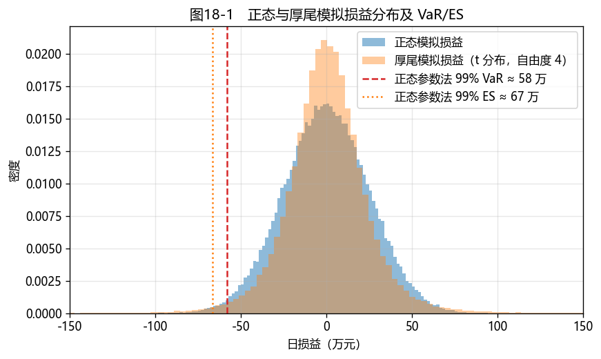
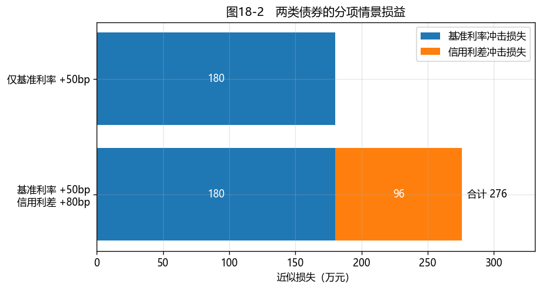

# 第18章　风险管理系统

[](https://colab.research.google.com/github/albertandking/fixed-income/blob/main/notebooks/ch18_risk_management.ipynb) [](https://mybinder.org/v2/gh/albertandking/fixed-income/main?labpath=notebooks/ch18_risk_management.ipynb)

!!! info "配套代码"
    本章用 `fi.var` 演示 VaR/CVaR、单一利率冲击下的情景损益，并用**模拟**的正态与厚尾损益比较估计结果。现有主 notebook 没有真实国债与信用债持仓或历史行情；配套解答中的多品种组合也仅是简化教学示例。

## 18.1 本章导读与学习目标

本章讨论债券组合在不利市场情景下的潜在损失。定价、久期、收益率曲线和信用分析都是识别与计量风险的基础。

风险可以从多个角度度量：**VaR/CVaR** 描述给定模型和持有期下的损益分布；**情景分析**计算指定市场冲击下的损益；**压力测试**考察较严重冲击下的承受能力。第16章讨论的回购续作风险说明，价格波动指标还需与融资和流动性分析结合。本章通过可复核的示例介绍这些方法。

!!! abstract "学习目标"
    学完本章，读者应能：

    1. 解释**历史模拟、参数法、蒙特卡洛**三种 VaR 估计方法，区分真实历史损益与模拟样本；
    2. 解释 **CVaR（期望损失/ES）**比 VaR 多提供了哪些尾部信息；
    3. 设计**压力测试与情景分析**（利率平移、曲线变陡、信用利差走阔）；
    4. 了解**监管资本与合规**框架（巴塞尔、IRRBB、流动性指标）；
    5. 用 `fi.var` 复算教学示例，将简化组合的利率与信用利差冲击分项计算，并说明真实评估还需哪些持仓、估值和风险因子数据。

!!! note "本章知识结构"
    **VaR**（18.2，三要素：置信水平/持有期/分布）→ 历史 / 参数 / 蒙特卡洛三法
    　↓ 观察尾部平均损失
    **CVaR（ES）**（18.2.2，尾部平均损失与次可加性）
    　↓ 正常市场之外
    **压力测试与情景分析**（18.3，利率/信用/流动性、历史灾难）
    　↓ 制度化
    **监管（巴塞尔/IRRBB/流动性）**（18.6）→ 教学案例：风险度量的最小演示（18.7）

---

## 18.2 风险价值 VaR 与条件风险价值 CVaR

### 18.2.1 VaR 的定义

**风险价值（Value at Risk, VaR）**是给定持有期、置信水平和损益模型后的**损失分位数**。例如 1 日 99% VaR 为 58 万元，表示在模型假设成立时，日损失超过该数的模型概率约为 1%；它不是"明天最多只会亏 58 万元"的保证。

VaR 的优点是便于在不同持仓和限额之间比较，但它只给出一个**尾部门槛**，不说明越过门槛后平均损失多少。它还依赖持仓、历史窗口、分布假设和定价模型；市场条件改变时，估计误差可能显著扩大：2008 年国际金融危机期间，不少机构以危机前平稳时期数据估计的 VaR，明显低估了随后发生的实际损失。因此不能只看一个 VaR 数字，还要结合尾部损失、情景分析、压力测试和模型回测。

VaR 需三个要素：**置信水平**（99%/95%）、**持有期**（1 日/10 日）、**损益分布**。三种估计方法：

| 方法 | 做法 | 优点 | 缺点 |
|---|---|---|---|
| **历史模拟法** | 用真实历史风险因子变动重估当前持仓，或用可比历史损益取经验分位数 | 不预设正态分布 | 依赖样本期间与数据质量；过去未出现的冲击可能缺席 |
| **参数法（方差-协方差）** | 在零均值、正态损益假设下，VaR $=z_\alpha\sigma$ | 简单快速 | 正态模型可能漏估厚尾和非线性风险 |
| **蒙特卡洛法** | 模拟大量情景取分位数 | 灵活、可含非线性 | 计算量大、依赖模型 |

在**单一利率因子、线性近似**下，债券头寸的损益标准差可写作 $\sigma_{P\&L}\approx$ **修正久期 × 市值 × 收益率变动标准差**。多只债券的组合还需考虑各期限利率与信用利差的相关性，不能简单套用某一只券的久期。

!!! example "例18.1：参数法 VaR/CVaR"
    组合市值 1 亿、修正久期 5、日收益率波动 5bp。损益标准差 $=5\times10^8\times0.0005=250{,}000$ 元/日。

    | 置信水平 | 1 日 VaR | 1 日 CVaR |
    |---|---|---|
    | 95% | 411,213 | 515,678 |
    | 99% | **581,587** | **666,304** |

    在**零均值正态损益**假设下，99% 1 日 VaR 约为 58 万元；实际损失仍可能超过这一数值。

### 18.2.2 CVaR：尾部平均损失

VaR 给出尾部门槛，**条件风险价值（CVaR，也称期望损失 ES）**刻画该置信水平下最差一部分结果的**平均损失**。在本章连续分布示例中，可直观理解为损失超过 VaR 后的平均损失；例18.1的 99% ES 约为 67 万元，高于约 58 万元的 VaR。

可把 VaR 想成一道**损失门槛**，ES 则描述越过门槛后最差一部分结果的平均深度。两个组合即使 VaR 相同，尾部平均损失也可能不同。ES 因而提供额外信息，但仍依赖同一套持仓、样本和模型假设，不能代替压力测试。

ES 在通常的定义下满足**次可加性**：同一风险模型下，组合的 ES 不大于各部分 ES 之和。VaR 在一般分布下不一定满足这一性质；这并不意味着任何资产组合都会因分散化降低实际风险。巴塞尔市场风险框架（FRTB）的**内部模型法**使用 ES：采用 97.5% 单尾置信水平，以 10 天为基础期限并按各风险因子的流动性期限调整，且须以压力时期校准。因此须区分本章的 1 日 99% 教学示例与监管资本采用的模型、置信水平及流动性期限要求。

!!! example "例18.2：同一波动尺度下的分布假设比较"
    以标准差约 25 万元的**模拟损益**为例，分别用正态参数法、正态蒙特卡洛和厚尾模拟样本的经验分位数计算 99% 1 日 VaR：

    | 方法 | 99% VaR |
    |---|---|
    | 参数法（正态） | 581,587 |
    | 蒙特卡洛（正态） | 585,738 |
    | **厚尾模拟样本的经验分位数** | **659,080** |

    在这一特定的厚尾模拟中，经验分位数高于正态模型结果；这说明**分布假设会影响尾部估计**。这里没有输入任何历史市场损益，因此第三列不能称为"历史模拟法的实证结果"，也不能据此断言正态法在所有市场时期都低估 VaR。

<figure markdown>
  { width="640" }
  <figcaption>图18-1　正态与厚尾模拟损益分布；竖线为正态参数法的 99% VaR 和 ES，供比较分布假设</figcaption>
</figure>

### 18.2.3 样本长度与模型检验

VaR 计算完成后，还应把**事先预测**的阈值与其后实际损益比较。若按每日 99% VaR 逐日检验，在模型校准且观察近似独立的理想条件下，250 个交易日的预期超限次数为 $250\times1\%=2.5$ 次。实际超限次数不必恰好等于 2 或 3；仅凭一年样本的几次超限，也不足以判定模型可靠或失效。连续出现超限、持仓或市场机制改变时，应进一步检查数据、模型与风险限额。

**历史模拟也受样本长度限制。** 250 个观测用于估计 99% 分位数时，最差约 2—3 个观测就会主导结果；它能作为教学演示，但不宜把一个短窗口算出的尾部数字当成稳定常数。应同时观察其他置信水平、不同样本窗口及压力情景。上述说明不涉及监管模型验证的完整要求。

---

## 18.3 压力测试与情景分析

VaR 根据选定样本和模型概括损益分布；若市场出现样本之外的变化，仅靠 VaR 可能漏掉重要风险。**情景分析**直接指定市场冲击，**压力测试**着重考察严重但仍需防范的冲击。

### 18.3.1 情景分析

对组合施加**特定的市场冲击**，直接重估损益（结合第6章久期凸性）：

$$\text{损益}\approx \text{市值}\times\big(-D\,\Delta y+\tfrac12 C\,\Delta y^2\big)$$

上式是**单一收益率平移**下的久期—凸性近似；曲线变陡、信用利差走阔等多因子情景，应分别给各期限和各持仓设定冲击并汇总损益。

!!! example "例18.3：利率情景分析"
    组合市值 1 亿、久期 5、凸性 30。不同利率冲击下的损益：

    | 情景 | 组合损益 |
    |---|---|
    | +100bp | −4,850,000 |
    | +200bp | −9,400,000 |
    | −100bp | +5,150,000 |

    注意 +200bp 的损失（−940 万）小于 +100bp 的两倍（−970 万）——**正凸性减轻了大幅上行的损失**（第6章）。

### 18.3.2 压力测试

**压力测试**用**严重但有分析价值**的历史或假设情景审视组合承受能力：

- **利率情景**：平移、变陡/变平、扭曲；
- **信用情景**：利差全面走阔、评级下迁、违约率跳升（第14章）；
- **流动性情景**：资金面骤紧、回购续作失败（第16章）；
- **历史情景**：复现 **2013 钱荒、2016 债灾、2020 永煤、2022 理财赎回潮**的市场冲击。

压力测试不追求概率，而着眼于一个问题：**若那样的冲击再度发生，组合能否承受。**

### 18.3.3 从单一久期到分项情景

例18.3把整个组合视作一个久期，适合说明**平行利率冲击**。若组合同时含利率债和信用债，就要区分**无风险利率变化**与**信用利差变化**。对第 $i$ 只债券，忽略凸性、违约及交易费用时，可用

$$\Delta V_i\approx -V_iD_i\big(\Delta r_i+\Delta s_i\big)$$

估算损益。其中 $V_i$ 为该券市值，$D_i$ 为其修正久期，$\Delta r_i$ 为对应期限的基准利率变化，$\Delta s_i$ 为信用利差变化；纯国债示例可令 $\Delta s_i=0$。把各券估计值相加即可得到组合近似损益。不同期限的 $\Delta r_i$ 不必相同，因而曲线变陡情景不能只输入一个全组合久期和单一 $\Delta y$。

!!! example "例18.4：两类债券的分项冲击"
    假设组合有市值 **6000 万元、修正久期 4** 的国债，以及市值 **4000 万元、修正久期 3** 的信用债。两只债券对应的基准利率均上行 **50bp**；信用债利差另外走阔 **80bp**。所有金额均为教学假设，忽略凸性、违约和流动性折价。

    | 风险来源 | 近似损益 |
    |---|---:|
    | 国债：基准利率 +50bp | $-6000\text{ 万}\times4\times0.005=-120\text{ 万元}$ |
    | 信用债：基准利率 +50bp | $-4000\text{ 万}\times3\times0.005=-60\text{ 万元}$ |
    | 信用债：利差 +80bp | $-4000\text{ 万}\times3\times0.008=-96\text{ 万元}$ |
    | **组合合计** | **−276万元** |

    若只施加利率平行上行 50bp，组合损失为 **180 万元**。另外 96 万元来自信用利差情景，不能归入国债利率风险。按每 1bp 变化估算，组合基准利率 DV01 约为 **3.6 万元/bp**，信用利差 DV01 约为 **1.2 万元/bp**；这里的 DV01 指收益率上行 1bp 时市值下降的**正数幅度**。

<figure markdown>
  { width="640" }
  <figcaption>图18-2　例18.4的线性久期近似：基准利率冲击导致 180 万元损失，额外信用利差冲击增加 96 万元损失；数值并非真实持仓或历史事件</figcaption>
</figure>

### 18.3.4 压力测试结果怎样使用

一个可复核的压力测试要记录**估值日与持仓**、每个风险因子的冲击、使用的价格或灵敏度、逐券损益及无法估计的风险。结果除了与风险限额比较，还应讨论融资是否能够续作、是否有足够流动资产应付现金需求，以及在必要时有哪些减仓或对冲措施。图18-2只计算价格敏感度，**没有**覆盖违约、保证金追加、买卖价差扩大和融资中断；不能用其 276 万元结果代表总压力损失。

---

## 18.4 Python 实现：`fi.var`

```python
from fi import var as v

import numpy as np

# 单一利率因子下的损益标准差（久期×市值×收益率波动）
sigma = v.bond_pnl_sigma(value=1e8, duration=5, yield_vol=0.0005)   # 250,000

# 三种方法的 99% VaR
v.parametric_var(sigma, alpha=0.99)            # 581,587
v.monte_carlo_var(sigma, alpha=0.99)           # (var, cvar)
# 下列序列为厚尾模拟，不是历史行情；仅演示经验分位数接口
pnl_series = np.random.default_rng(7).standard_t(4, 100000) * sigma / np.sqrt(2)
v.historical_var(pnl_series, alpha=0.99)       # 约 659,080

# CVaR（期望损失）
v.parametric_cvar(sigma, alpha=0.99)           # 666,304

# 情景分析 / 压力测试
v.scenario_pnl(value=1e8, duration=5, convexity=30, dy=0.01)   # -4,850,000

# 例18.4：逐项线性久期近似；fi.var.scenario_pnl 的单因子接口不能直接代替此分解
gov_rate_pnl = -60_000_000 * 4 * 0.005
credit_rate_pnl = -40_000_000 * 3 * 0.005
credit_spread_pnl = -40_000_000 * 3 * 0.008
portfolio_pnl = gov_rate_pnl + credit_rate_pnl + credit_spread_pnl  # -2,760,000
```

`bond_pnl_sigma` 和 `scenario_pnl` 都采用单因子近似。`historical_var` 计算传入序列的经验分位数；**只有输入真实历史损益或历史风险因子冲击后的重估损益时，才构成历史模拟法**。`monte_carlo_var` 在当前实现中抽取正态损益情景，因此并未展示非线性头寸的重新定价。

---

## 18.5 QuantLib 综合应用

对含权债券和衍生品，可在各情景下重新设定利率、波动率或信用参数，使用 QuantLib 等工具**重新定价**并汇总组合损益。要形成可用的风险流程，还须统一估值日、市场数据、持仓数量、模型校准与情景定义，并检验计算结果；本章的 `fi.var` 示例尚未实现这一整套流程。

!!! tip "全价值重估 vs 灵敏度法"
    **灵敏度法**用久期、凸性等估计小幅冲击的损益，计算较快；**全价值重估**在各情景下重新定价，能够表示模型中的非线性，但仍受模型与市场数据质量限制。冲击幅度较大、产品非线性明显时，应检查灵敏度近似误差。

---

## 18.6 监管要求与合规

风险管理也是监管要求。固定收益相关的主要框架：

- **巴塞尔市场风险框架（FRTB）**：其**内部模型法**使用预期损失（ES），与本章的 1 日 99% VaR 教学计算不是同一监管口径；标准法另有资本计量规则；
- **银行账簿利率风险（IRRBB）**：评估利率冲击下的经济价值变动（ΔEVE）与净利息收入变动（ΔNII）。巴塞尔框架规定 EVE 六种标准冲击、NII 两种标准冲击；冲击幅度按币种和现行规则确定，不宜一概写成 ±200bp；
- **流动性指标**：流动性覆盖率（LCR）、净稳定资金比率（NSFR）；
- **中国监管**：适用机构须按国内现行资本、市场风险、流动性及银行账簿利率风险规定执行；例如金融监管总局 2025 年 6 月印发、自印发之日起施行的《商业银行市场风险管理办法》（金规〔2025〕15 号）明确，所称市场风险不包含银行账簿利率风险，后者适用《商业银行银行账簿利率风险管理指引（修订）》。

监管要求提供了风险计量、限额和报告的制度框架；具体适用口径应以机构类型及现行规则为准。

---

## 18.7 教学案例：风险度量的最小演示

配套 notebook 依次演示：

1. **VaR/ES 计算**：假设市值 1 亿元、修正久期 5、日收益率波动 5bp，算出单一利率因子下的损益标准差与正态模型 VaR/ES；
2. **分布假设比较**（图18-1）：生成正态与厚尾模拟损益，比较参数法、正态蒙特卡洛与厚尾样本经验分位数；
3. **利率情景**：对 +100bp、+200bp 和 −100bp 平移，用久期—凸性公式估计损益；
4. **分项风险情景**（图18-2）：对一个两类债券的假设组合，分别计算基准利率与信用利差冲击的近似损益。

**案例边界**：这里没有真实历史行情、国债加信用债的逐券持仓，也没有复现某一历史危机或生成完整风控仪表盘。习题解答 notebook 提供多品种估值和平均久期的简化示例，可作为扩展起点；若要形成真实组合评估，至少还需持仓数量、各期限与信用利差冲击、风险因子相关性和可核验的估值数据。

---

## 18.8 习题与编程实验

**概念题**

1. VaR 的三要素是什么？历史/参数/蒙特卡洛三法各自的优缺点？
2. ES 相对 VaR 多反映了什么信息？巴塞尔市场风险框架的哪一种计量方法使用 ES？什么是次可加性？
3. 在怎样的损益分布下，正态参数法可能低估尾部损失？为什么不能仅凭本章模拟结果得出普遍结论？
4. VaR 与压力测试分别回答什么问题？为什么二者缺一不可？

**计算题**

5. 组合市值 2 亿、久期 4、日收益率波动 6bp，求日损益标准差与 99% 1 日参数法 VaR、CVaR。
6. 组合久期 6、凸性 50、市值 1 亿，求 +150bp 与 −150bp 情景下的损益，比较凸性的作用。

**编程实验**

7. 用 `fi.var` 复现本章的正态参数法、正态蒙特卡洛与厚尾**模拟样本**经验分位数，注明各自的输入及假设；若另有真实历史损益，再尝试历史模拟。
8. 用 `fi.var.scenario_pnl` 制作利率**平移**情景表；再按例18.4的分项公式计算两类债券的利率与利差损益。说明为何曲线变陡还需要逐期限冲击。
9. 扩展：为国债、信用债、可赎回债和利率互换列出持仓数量及估值，讨论汇总久期、信用利差和非线性风险时，简单平均久期会遗漏什么。

---

## 18.9 习题参考答案与详解

!!! tip "编程实验示例 notebook"
    [`notebooks/solutions/ch18_solutions.ipynb`](https://colab.research.google.com/github/albertandking/fixed-income/blob/main/notebooks/solutions/ch18_solutions.ipynb)给出模拟分布、单因子情景和多品种估值示例；它不是带真实持仓及历史数据的完整风险系统。

!!! success "概念题 1"
    **VaR 三要素**：置信水平、持有期和损益分布。**历史模拟**用真实历史变动或可比历史损益形成经验分位数，依赖样本选择；**参数法**在零均值正态假设下使用 $z_\alpha\sigma$，计算快，但可能漏估厚尾和非线性；**蒙特卡洛**从指定模型抽取情景，可表示较复杂风险，但结果取决于所选模型。现有 notebook 的厚尾样本是模拟数据，不是历史行情。

!!! success "概念题 2"
    **ES** 刻画最差一部分结果的平均损失，比 VaR 多反映尾部深度。次可加性写作 $\rho(A+B)\le\rho(A)+\rho(B)$；ES 在通常定义下满足，VaR 对一般分布不保证满足。巴塞尔 **FRTB 内部模型法**采用 ES，但本章 1 日 99% 示例并非该监管资本计算。

!!! success "概念题 3"
    若实际损益相对正态分布有较重尾部，正态参数法**可能**低估某些置信水平下的损失分位数；若样本期、持仓或模型不同，方向未必相同。本章的厚尾样本由程序生成，只能说明**这个设定下**的结果，不能证明真实市场总会如此。

!!! success "概念题 4"
    **VaR** 在给定模型下概括指定分位数的潜在损失；**压力测试**回答指定严重冲击下会损失多少，通常不赋予精确发生概率。两者检视的角度不同，且都依赖数据、估值及情景设计。

!!! success "计算题 5"
    日损益标准差 $\sigma=$ 久期 × 市值 × 收益率波动 $=4\times2\text{亿}\times0.0006=\mathbf{480{,}000}$ 元。

    - **99% 1 日参数法 VaR** $=z_{0.99}\sigma=2.326\times480000\approx\mathbf{1{,}116{,}647}$ 元；
    - **99% CVaR** $=\sigma\,\phi(z_{0.99})/(1-0.99)\approx\mathbf{1{,}279{,}303}$ 元（> VaR）。

    （用 `fi.var.bond_pnl_sigma`、`parametric_var`、`parametric_cvar` 验证。）

!!! success "计算题 6"
    情景损益 $=$ 市值 $\times(-D\,\Delta y+\tfrac12 C\,\Delta y^2)$，$D=6$、$C=50$、市值 1 亿：

    - **+150bp**：$10^8\times(-6\times0.015+\tfrac12\times50\times0.015^2)=\mathbf{-8{,}437{,}500}$ 元；
    - **−150bp**：$10^8\times(+6\times0.015+\tfrac12\times50\times0.015^2)=\mathbf{+9{,}562{,}500}$ 元。

    上行亏 843.75 万、下行赚 956.25 万——**不对称**：正凸性让下行赚得比上行亏得多（差额 $2\times\tfrac12 C\Delta y^2\times MV=112.5$ 万元，即凸性的贡献）。

!!! success "编程实验 7–9（要点）"
    - **实验 7**：比较正态参数法、正态蒙特卡洛及厚尾模拟样本的经验分位数；图18-1画的是**模拟分布**，不能当成历史回测图。
    - **实验 8**：`scenario_pnl` 可直接演示单一收益率平移。例18.4的分项计算得到利率损失 180 万元、利差损失 96 万元、合计 276 万元；解答 notebook 另有更换整体久期与收益率冲击的近似示意，未逐期限、逐券建模，不能据此声称完成曲线变陡或信用利差压力测试。
    - **实验 9**：解答 notebook 展示几种工具的估值，并用前三类债券的**平均久期**示意组合 VaR；它没有按持仓数量、信用利差相关性及互换风险完整汇总，因此不能称作完整风险仪表盘。

---

## 18.10 本章小结

- **VaR** 是指定持有期和模型下的损失分位数；历史模拟、参数法和蒙特卡洛的结果取决于数据与假设。
- **CVaR（ES）** 刻画最差一部分结果的平均损失；巴塞尔市场风险框架的内部模型法使用 ES，监管口径与本章示例不同。
- **压力测试与情景分析**审视极端情景（利率/信用/流动性、历史灾难），是 VaR 的必要补充。
- 灵敏度法便于快速估算，全价值重估可表示更多非线性，但两者都需要可靠的估值与数据。
- `fi.var` 提供教学用分位数与单因子情景计算；真实组合风控还需要持仓、数据、限额、验证和报告流程。
- 分项情景须分别给各持仓和风险因子设定冲击；短样本的尾部估计与单一久期近似都有清晰的适用边界。

---

!!! note "全书结语"
    本书从"一串约定的现金流"出发，依次讨论了**定价**（现值与时间价值）、**收益率与期限结构**（折现率的结构）、**利率风险度量**（久期与凸性）、**债券品种**（浮息、含权、可转换、信用与结构化产品）、**衍生品**（期货、互换与期权），以及**市场机制与综合应用**（回购融资、投资策略和风险管理）。贯穿全书的主线是：**未来现金流的现值，以及该现值对利率、信用利差和融资条件的敏感度**。这些分析都建立在明确现金流、估值日和市场假设的基础上。

    `fi` 代码与示意案例用于说明计算方法，部分章节另以 QuantLib 交叉核对计算结果。应用于真实市场时，还应核对数据来源、产品条款、模型假设和适用的监管要求，计算工具不能替代这些核验。固定收益领域还有利率期限结构模型（如 HJM）、波动率模型（如 SABR）和信用衍生品等更深入的内容，本书的框架与工具可作为进一步学习的基础。

!!! note "关键公式速查"
    | 概念 | 公式 |
    |---|---|
    | 单因子损益标准差 | σ ≈ 修正久期 × 市值 × 收益率变动标准差 |
    | 参数法 VaR | $z_\alpha\sigma-\mu$ |
    | 参数法 CVaR | $\sigma\,\phi(z_\alpha)/(1-\alpha)-\mu$ |
    | 历史模拟 VaR | $-Q_{1-\alpha}(P\&L)$，输入应为历史损益或历史冲击重估损益 |
    | 情景损益 | 市值 ×(−D·Δy + ½C·Δy²) |
    | 预期损失 | EL = PD × LGD × EAD |

!!! quote "延伸阅读"
    - Jorion, P. *Value at Risk: The New Benchmark for Managing Financial Risk*（VaR 经典）；
    - 巴塞尔委员会：[市场风险最低资本要求](https://www.bis.org/publications/201901-standards-minimum-capital-requirements-market-risk)与[现行银行账簿利率风险框架](https://www.bis.org/committees/bcbs/basel-framework/standard/srp/31/inforce/2026-01-01/published/2024-07-16)；
    - Fabozzi, *Bond Markets, Analysis, and Strategies*，风险管理相关章节；
    - 国家金融监督管理总局：[《商业银行市场风险管理办法》发布说明](https://www.nfra.gov.cn/cn/view/pages/ItemDetail.html?docId=1214421&generaltype=0&itemId=915)与[印发通知全文](https://www.nfra.gov.cn/cn/view/pages/governmentDetail.html?docId=1214382&itemId=861&generaltype=1)（金规〔2025〕15 号）。
